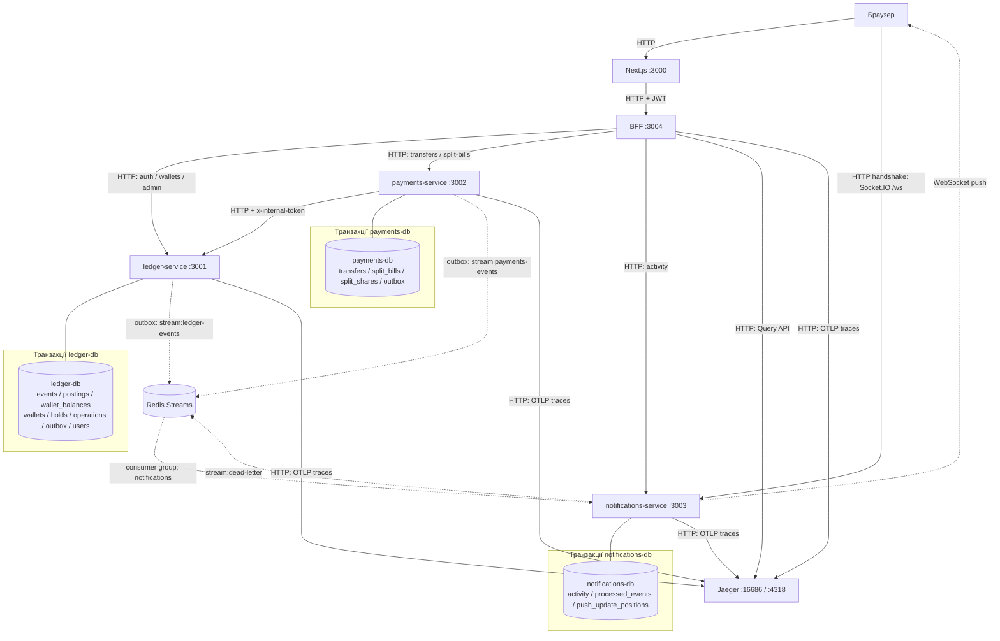

# P2P Ledger

Мультивалютні гаманці (USD/EUR/UAH), P2P-перекази та split-рахунки:
PostgreSQL event store, double-entry облік, оркестрована сага, Redis Streams,
Socket.IO й наскрізне OpenTelemetry-трасування. Реалізація розвиває наданий
стартер за [технічним завданням](ЗАВДАННЯ.md). Поповнення й виведення —
локальні моки; зовнішніх банківських інтеграцій немає.

Стек збережено: Node 20, NestJS 10, Next.js 14 (App Router), TypeORM 0.3,
PostgreSQL 16, Redis 7. Кожен пакет має власні залежності та lockfile.

## Архітектура



Суцільні стрілки — синхронні HTTP-виклики, пунктирні — асинхронні події
та WebSocket push. Лінії без стрілок — доступ сервісу до власної
PostgreSQL. BFF і frontend не мають БД; сервіси не читають чужих БД.

- **Ledger** володіє грошима, event store та синхронними проєкціями. Auth
  лишився окремим модулем у цьому процесі; гаманець знає лише `ownerId`,
  ORM-зв'язку з `User` немає.
- **Payments** володіє станом саги й split-рахунками. FX — внутрішній модуль
  із мок-курсами та TTL-кешем. Гроші змінює лише через internal API ledger.
- **Notifications** будує персональну стрічку з подій і надсилає push.
- **BFF** перевіряє JWT/DTO, проксує явні маршрути, агрегує dashboard та
  перетворює Jaeger traces для адмінки. **Frontend** викликає BFF; браузер
  підключається до notifications напряму лише для Socket.IO.

Транзакційні межі: у ledger команда комітить події, проводки, проєкції,
результат ідемпотентної операції й outbox разом. У payments перехід саги,
відповідний фінал split-частки та outbox комітяться разом. HTTP між ними
виконується поза цими транзакціями. У notifications одна транзакція фіксує
дедуплікацію, activity й позиції push; emit та ACK ідуть після коміту.
Спільної транзакції між PostgreSQL і Redis чи між сервісами немає.

### Чому ці рішення

| Рішення | Причина та компроміс |
|---|---|
| PostgreSQL append-only event store | Подія, проводки, проєкція та outbox атомарні в уже наявній БД. Окремий EventStoreDB не потрібен для цього обсягу; версіонування й replay реалізовано в коді. |
| Redis Streams | Журнал доменних подій, consumer groups, ACK, reclaim і replay утримуваної історії в одному легкому контейнері. Kafka/RabbitMQ додали б операційні витрати; retries, DLQ та trace propagation тут реалізовані явно. Історія обмежена `MAXLEN ~`. |
| Оркестрована сага | Payments має одного власника стану, порядку кроків і компенсації. Це спрощує аудит фінансового флоу та відновлення після падіння; координатор потребує стійкого стану й lease. |
| REST BFF на NestJS | Єдина HTTP-точка для frontend, валідація, агрегація та Swagger без GraphQL-схеми для одного клієнта. Додатковий мережевий перехід компенсується паралельним читанням незалежних секцій. |
| Інтервальні воркери | `@nestjs/schedule` опитує стан у PostgreSQL через `FOR UPDATE SKIP LOCKED`; окрема черга задач не дублює вже збережений стан саги/outbox. |

## Модель узгодженості та облік

| Інваріант | Де й коли гарантується | Чому |
|---|---|---|
| Для кожної грошової події й валюти Σ DEBIT = Σ CREDIT | Синхронно: `EventStore.append` перевіряє проводки до запису в ledger-транзакції | Незбалансована операція не комітиться; міжвалютна операція балансується окремо в обох валютах. |
| `available >= 0`, `held >= 0`; немає double spend | Синхронно: блокування `wallet_balances FOR UPDATE` у порядку wallet ID, перевірка коштів і CHECK у БД | Конкурентні команди одного гаманця серіалізуються; capture блокує обидва гаманці. |
| Подія, проводки й поточний баланс відповідають одне одному | Синхронно: одна ledger-транзакція; UNIQUE `(stream_id, stream_version)` | CQRS розділяє запис і читання логічно, але проєкція гаманця не відстає від успішної команди. |
| Event store і проводки незмінні | Синхронно: тригери забороняють UPDATE/DELETE/TRUNCATE `events` і `postings` | Виправлення відбуваються новими подіями, історія аудиту лишається. |
| Команда не виконується двічі | Синхронно в БД-власнику: `operations.operation_id` у ledger, UNIQUE `(sender_user_id, idempotency_key)` у payments, хеш тіла | Повтор повертає результат; інше тіло з тим самим ключем дає 422. Без необов'язкового ключа deposit/withdraw — нові операції. |
| Частку не оплачено двічі | Синхронно в payments: вставка переказу й умовний `ACCEPTED → PAYING` в одній транзакції | Лише одна нова оплата виграє; фінал саги разом змінює частку на PAID або ACCEPTED. |
| Списання відправника та зарахування отримувачу атомарні | Синхронно в ledger: одна capture-транзакція | Payments може ще не знати результат; грошового проміжку між списанням і зарахуванням немає. |
| Статус переказу наздоганяє ledger, холд зрештою capture/release | Eventual: сага, lease, повтори з тим самим operationId та компенсація | Падіння між HTTP і комітом payments відновлюється повтором; завершення потребує доступності ledger. |
| Коміт породжує сповіщення | Eventual: transactional outbox → Redis → notifications | Невідправлений outbox лишається в БД. XADD і `published_at` не атомарні між системами, тому дубль можливий і прибирається за eventId. Доставка залежить від доступності та утримання даних брокером. |
| Activity записано один раз, старий state push не замінює новий | Одна notifications-транзакція: `processed_events` + activity + `push_update_positions` | Дедуплікація за eventId і стабільна позиція outbox; WS-доставка після коміту не гарантована, REST на connect відновлює стан. |
| Replay збігається з проєкцією | Перевірка reconciliation у `REPEATABLE READ READ ONLY` | Один знімок БД: глобальні дебети/кредити за період і повний replay усіх подій для балансів; проєкція не перезаписується. |

Гроші зберігаються як `bigint` у мінорних одиницях; у JSON — десяткові рядки.
`amount: number` на API має бути додатним, ≤ 1 000 000 та з ≤ 2 знаками після
коми. Перетворення йде через рядок, без `amount * 100`.
`balance = available + held`: утримані гроші належать користувачу,
але не доступні до витрати.

| Операція | DEBIT | CREDIT |
|---|---|---|
| Deposit X | `system:external:CUR` X | `wallet:W:available` X |
| Withdraw X | `wallet:W:available` X | `system:external:CUR` X |
| Hold X | `wallet:W:available` X | `wallet:W:held` X |
| Release X | `wallet:W:held` X | `wallet:W:available` X |
| Capture, одна валюта | `wallet:S:held` X | `wallet:R:available` X |
| Capture, USD→EUR | `wallet:S:held` X USD; `system:fx:EUR` Y EUR | `system:fx:USD` X USD; `wallet:R:available` Y EUR |

Баланс рахунку гаманця = Σ CREDIT − Σ DEBIT. FX-курс зберігається з 8 знаками,
сума зарахування округлюється вниз до мінорної одиниці. Системні рахунки
`system:external:*` і `system:fx:*` забезпечують баланс проводок у кожній валюті.

## Запуск

Потрібні Docker із Compose v2 (для тестового override — v2.24.4+) та вільні
порти з таблиці нижче. Запускайте з кореня репозиторію:

```bash
docker compose up --build
```

Compose сам читає `.env.example` кожного пакета; копіювати їх для цього
запуску не потрібно. Варіант у фоні з очікуванням готовності:
`docker compose up -d --build --wait --wait-timeout 180`.

| Компонент | Адреса / порт хоста | Документація |
|---|---|---|
| Frontend | [localhost:3000](http://localhost:3000) | `/wallets`, `/transfers/new`, `/split-bills`, `/activity`, `/admin` |
| Ledger | [localhost:3001](http://localhost:3001) | [Swagger](http://localhost:3001/docs) |
| Payments | [localhost:3002](http://localhost:3002) | [Swagger](http://localhost:3002/docs) |
| Notifications | [localhost:3003](http://localhost:3003) | [Swagger](http://localhost:3003/docs), Socket.IO `/ws` |
| BFF | [localhost:3004](http://localhost:3004) | [Swagger](http://localhost:3004/docs) |
| Jaeger | [UI localhost:16686](http://localhost:16686), OTLP HTTP 4318 | `/api/traces` |
| PostgreSQL | ledger 5433, payments 5434, notifications 5435 | Усередині мережі кожна БД на 5432 |
| Redis | 6379 | Усередині мережі `redis:6379` |

Nest-сервіси мають `/health` і `/metrics`. Адмін-логін у локальному прикладі:
`admin@example.com` / `change-me-admin`; звичайних користувачів створюйте через
`/register`. Для демонстрації: два користувачі → USD-гаманець → поповнення →
переказ на email другого користувача (можна в EUR) → live-статус та activity.
Адмінка доступна після входу адміном; wallet ID береться зі списку гаманців.

Секрети `change-me-*` та паролі БД — публічні dev-значення. Для іншого
середовища задайте власні через env/Compose override, узгодивши
`JWT_ACCESS_SECRET` у всіх Nest-сервісах і `INTERNAL_API_TOKEN` у ledger/payments.
Ledger зберігає стартові fallback JWT-секрети й не валідує env на старті;
payments, notifications і BFF валідують конфігурацію. Плейсхолдери не
відхиляються валідатором: локальний приклад має запускатися без налаштувань.

Схема БД ledger створюється міграціями (`apps/ledger-service/src/migrations`),
вони застосовуються автоматично на старті сервісу; `synchronize` вимкнено.
Міграції всіх трьох БД застосовуються на старті, `synchronize: false`.
Міграції даних зі стартової схеми (баланс полем у `wallets`) немає. Якщо
залишився старий dev-том, його можна перестворити командою
`docker compose down -v`: **вона видалить усі три БД поточного Compose-проєкту**.
Для нової інсталяції ця команда не потрібна; важливі дані спершу збережіть.

Swagger ledger-service — http://localhost:3001/docs. Адмін створюється на
старті з `ADMIN_EMAIL` / `ADMIN_PASSWORD` (`apps/ledger-service/.env.example`);
роль admin має лише цей акаунт — після зміни `ADMIN_EMAIL` попередній адмін
стає звичайним користувачем. Адмін-ендпоінти — `/admin/*` (event-лог гаманця,
reconciliation, freeze). Заморожений гаманець не приймає й не віддає гроші
(deposit, withdraw, новий холд, зарахування переказу й списання холду на
користь отримувача → 409); холд на ньому можна лише зняти (компенсація саги).
Міжвалютне зарахування (`POST /internal/holds/:id/capture`) приймається, лише
якщо сума = сума холду × `fxRate` з точністю до однієї мінорної одиниці.
`POST /internal/holds/:id/release` приймає необов'язковий `walletId` гаманця
відправника. Для холду, якого ще немає (запит `POST /internal/holds` застряг, а
сага вже здалась і знімає холд), release блокує цей гаманець і лишає слід в
`operations`; запізнілий холд з тим самим `holdId` отримає `409 HOLD_NOT_ACTIVE`,
тож кошти не лишаються в `held` без власника. `walletId`, що не збігається з
гаманцем наявного холду, → `400`. Без `walletId` невідомий холд, як і раніше, → `404`.
Звірку можна запустити й скриптом: `docker compose exec ledger-service npm run reconcile`
(код виходу 1 — є розбіжності).

Для локальної розробки на Node 20 скопіюйте `.env.example` → `.env` у
потрібних пакетах і підніміть залежності:
`docker compose up -d ledger-db payments-db notifications-db redis jaeger`.
У `.env` змініть контейнерні адреси на хостові:

| Пакет | Перевизначення для запуску на хості |
|---|---|
| ledger-service | `DATABASE_HOST=localhost`, `DATABASE_PORT=5433`, `REDIS_HOST=localhost` |
| payments-service | `DATABASE_HOST=localhost`, `DATABASE_PORT=5434`, `REDIS_HOST=localhost`, `LEDGER_SERVICE_URL=http://localhost:3001` |
| notifications-service | `DATABASE_HOST=localhost`, `DATABASE_PORT=5435`, `REDIS_HOST=localhost` |
| bff | `LEDGER_SERVICE_URL=http://localhost:3001`, `PAYMENTS_SERVICE_URL=http://localhost:3002`, `NOTIFICATIONS_SERVICE_URL=http://localhost:3003`, `JAEGER_QUERY_URL=http://localhost:16686` |
| frontend | `BFF_URL=http://localhost:3004`, `WS_PUBLIC_URL=http://localhost:3003` |

Для всіх Nest-сервісів `OTEL_EXPORTER_OTLP_ENDPOINT=http://localhost:4318`.
У кожному backend-пакеті: `npm ci && npm run start:dev`; у frontend:
`npm ci && npm run dev`. Не запускайте паралельно контейнер і хостовий
процес одного сервісу на тому самому порту.

## Сага переказу (payments-service)

`POST /transfers` (JWT + обов'язковий заголовок `Idempotency-Key`, 1–128 символів) лише створює переказ у статусі `PENDING` і відповідає `202`; далі його веде фоновий saga runner. Статус — `GET /transfers/:id`: відправник бачить переказ завжди, отримувач — лише після зарахування (`COMPLETED`; невдалі й незавершені перекази його не стосуються), іншим — 404; список — `GET /transfers?limit=`. Swagger — http://localhost:3002/docs.

- **Оркестрація.** Координатор — payments-service, стан саги — рядок `transfers` (`status` + `step`). Кроки: `RISK_CHECK` (ліміт `TRANSFER_MAX_AMOUNT`, чорний список `BLOCKED_EMAILS`) → `RESOLVE_RECIPIENT` (користувач за email, переказ собі відхиляється за `userId`, і його гаманець у валюті зарахування, створюється за потреби) → `FX_QUOTE` (курс з кешу, сума зарахування округлюється вниз) → `HOLD` → `CONFIRM` (курс не старший `FX_MAX_QUOTE_AGE_MS`, отримувач не заморожений) → `CAPTURE` (списання з холду й зарахування отримувачу — одна транзакція в ledger).
- **Компенсація.** Відмова до холду → `FAILED`, відкочувати нічого. Відмова на `CONFIRM`/`CAPTURE` → `COMPENSATING` → `RELEASE_HOLD` (кошти повертаються в available, ledger пише `TransferFailed`) → `FAILED`. Компенсація повторюється, доки ledger її не прийме. Release передає гаманець відправника (`walletId`): якщо запит на холд застряг і ledger його ще не бачив, release під блокуванням гаманця лишає слід (запис в `operations`), і запізнілий холд отримує `409 HOLD_NOT_ACTIVE` замість того, щоб назавжди зависнути в `held`. Якщо ledger відповідає на release `HOLD_NOT_ACTIVE` або `422 IDEMPOTENCY_KEY_REUSED` (release з цим `operationId` уже виконано з іншим тілом), результат компенсації визначає стан холду: `CAPTURED` → `COMPLETED`, `RELEASED` чи холду немає → `FAILED`.
- **Невизначений результат** (5xx, таймаут, відкритий circuit breaker) — не відмова: `AWAITING_RETRY` з exponential backoff, той самий крок з тим самим `operationId` (`transfer:<id>:<крок>`), тож у ledger він виконується один раз. Після `SAGA_MAX_ATTEMPTS` кроки до холду → `FAILED`, `HOLD`/`CONFIRM` → компенсація. `CAPTURE` ніколи не компенсується наосліп: після вичерпання спроб runner питає стан холду (`CAPTURED` → `COMPLETED`, `ACTIVE` → компенсація), а поки ledger недоступний — чекає далі.
- **Застряглі саги.** Runner бере переказ під lease (`locked_until` = `SAGA_STEP_TIMEOUT_MS`) короткою транзакцією з `FOR UPDATE SKIP LOCKED`; HTTP-виклик іде поза транзакцією, результат фіксується окремою транзакцією разом з outbox. Процес упав посеред кроку — lease протухає, і переказ підхоплює інший runner; запізнілий результат старого runner'а відкидається. Тік runner'а чекає всі перекази пачки (`Promise.allSettled`), а circuit breaker зупиняється вже після нього (`onApplicationShutdown`), тож крок, що виконується на SIGTERM, не втрачає ledger. Обмеження: новий тік не стартує, поки найповільніший переказ пачки не завершився; для більшого навантаження варто було б брати нові перекази, щойно звільнюється слот (пул воркерів) — тут цього не робили.
- **Circuit breaker** (`opossum`) на всіх викликах ledger: після відкриття виклики швидко відхиляються, після `CB_RESET_TIMEOUT_MS` дозволяється пробний виклик. Невизначені відповіді ведуть до `AWAITING_RETRY`. Остаточні 4xx-відмови breaker не рахує як збої; 401/403/408/429 повторюються як тимчасові помилки.
- **Ідемпотентність.** `UNIQUE(sender_user_id, idempotency_key)` + `INSERT … ON CONFLICT DO NOTHING`: паралельні дублі чекають на коміт першого запиту й отримують той самий переказ (`200`); той самий ключ з іншим тілом → `422 IDEMPOTENCY_KEY_REUSED`.
- **Події.** Кожна зміна `status`/`step` пише в outbox `TransferStatusChanged` у тій самій транзакції; relay публікує їх у `stream:payments-events`.
- **Rate limit** на `POST /transfers` — за `userId` з JWT (`TRANSFER_RATE_LIMIT` за `TRANSFER_RATE_TTL_MS`).
- Одержувач — лише email: username в auth-модулі немає, а auth не розширюємо.
- `TRANSFER_MAX_AMOUNT` — спрощене мок-правило: одне число в одиницях валюти переказу для всіх валют.
- Env payments-service валідується на старті (`ConfigModule.forRoot({ validate })`): без обов'язкових змінних сервіс не стартує. Пов'язані таймаути звіряються: `FX_CACHE_TTL_MS < FX_MAX_QUOTE_AGE_MS` (інакше курс із кешу міг би застаріти до кроку `CONFIRM`) і `CB_TIMEOUT_MS < SAGA_STEP_TIMEOUT_MS` (інакше lease кроку спливав би посеред виклику ledger).
- Переказ собі: ledger розрізняє email за регістром (`Bob@x.com` і `bob@x.com` — різні акаунти), тому порівняння рядків у `RISK_CHECK` прибрано: збіг визначає `RESOLVE_RECIPIENT` за `userId`. Чорний список порівнюється без урахування регістру.

### Відмови й компенсація по кроках

| Крок | Успішна дія | Остаточна відмова | Таймаут / 5xx / breaker open |
|---|---|---|---|
| RISK_CHECK | Перевірка ліміту й чорного списку | FAILED, гроші не змінені | Локальний крок; неочікувана помилка повторюється до ліміту спроб, потім FAILED. |
| RESOLVE_RECIPIENT | Пошук користувача, заборона переказу собі, ensure гаманця | FAILED, гроші не змінені; створений порожній гаманець не видаляється | Повтор із backoff, після ліміту FAILED. |
| FX_QUOTE | Зберегти курс, час і суму зарахування | FAILED, холду ще немає | Повтор до ліміту; потім FAILED. |
| HOLD | Перенести available → held, `transfer:<id>:hold` | FAILED: ledger відхилив команду без зміни грошей | Повторити ту саму команду; після ліміту перейти до RELEASE_HOLD, бо холд міг бути створений. |
| CONFIRM | Перевірити вік курсу й frozen отримувача | COMPENSATING → RELEASE_HOLD → FAILED | Повтор до ліміту, потім RELEASE_HOLD. |
| CAPTURE | Атомарно списати held та зарахувати отримувачу, `transfer:<id>:capture` | RELEASE_HOLD → FAILED | Повторити capture; після ліміту спитати стан холду: CAPTURED → COMPLETED, інший стан → компенсація; недоступний ledger → чекати з backoff. |
| RELEASE_HOLD | Повернути held → available, `transfer:<id>:release`, записати причину | NOT_FOUND → FAILED; HOLD_NOT_ACTIVE / IDEMPOTENCY_KEY_REUSED → перевірити холд: CAPTURED → COMPLETED, RELEASED/немає → FAILED, ACTIVE → повтор | Без ліміту повторів, доки результат не визначено; статус COMPENSATING зберігається. |
| DONE / сповіщення | COMPLETED і outbox уже закомічені | Збій доставки сповіщення не відкочує гроші | Relay/consumer повторюють доставку; REST повертає зафіксований стан. |

`attempts` рахується для поточного кроку й скидається при переході. Backoff:
`min(SAGA_RETRY_BASE_MS × 2^attempts, 60000)` мс. FAILED зберігає крок відмови;
після компенсації це RELEASE_HOLD. DONE означає лише COMPLETED.
Невідомий результат capture не прирівнюється до відмови: навіть якщо
release змагається із запізнілим capture, ledger серіалізує їх, і сага
визначає фінал за станом холду. Release невідомого холду з `walletId`
лишає слід, який забороняє запізнілий place.

Приклад (стек запущено `docker compose up --build`; `ACCESS`, `WALLET` — токен і USD-гаманець відправника з ledger, у гаманці є кошти; отримувач `bob@example.com` зареєстрований):

```bash
curl -s -X POST http://localhost:3002/transfers \
  -H "Authorization: Bearer $ACCESS" -H "Idempotency-Key: $KEY" \
  -H 'Content-Type: application/json' \
  -d "{\"fromWalletId\":\"$WALLET\",\"toWalletIdentifier\":\"bob@example.com\",\"amount\":10,\"currency\":\"USD\",\"toCurrency\":\"EUR\"}"
```

Перед першим запитом задайте `KEY=$(uuidgen)`; для повтору використовуйте
те саме значення та тіло. Новий ключ означає нову операцію.

## Split-рахунки (payments-service)

Ініціатор створює груповий рахунок: загальна сума, валюта, учасники (за email) і частки. Кожен учасник підтверджує свою частку й сплачує її окремим переказом на email ініціатора — тією самою сагою, що й звичайний переказ. Swagger — http://localhost:3002/docs.

- `POST /split-bills` `{ title, totalAmount, currency, mode, participants: [{ email, amount? }], dueAt? }` + необов'язковий `Idempotency-Key` → `201`; повтор з тим самим ключем — `200` і той самий рахунок (без дубліка й другої події), той самий ключ з іншим тілом — `422 IDEMPOTENCY_KEY_REUSED`; без ключа кожен запит створює новий рахунок (ключ необов'язковий, бо створення рахунку — мутація без чутливості до реального часу, яку фронтенд викликає Server Action'ом). `mode: EQUAL` — порівну, залишок мінорних одиниць (копійок) отримує перший учасник (100.00 / 3 → 33.34, 33.33, 33.33); `CUSTOM` — суму кожного задає ініціатор, їх сума має дорівнювати `totalAmount`, інакше `400 SHARES_SUM_MISMATCH`. До 20 учасників; учасник — зареєстрований користувач (інакше `400 PARTICIPANT_NOT_FOUND`), без повторів. Кожна частка має вкладатись у `TRANSFER_MAX_AMOUNT` (`400 SHARE_LIMIT_EXCEEDED`), а ініціатор і учасники не можуть бути в `BLOCKED_EMAILS` (`400 BLOCKED_PARTICIPANT`): інакше частку неможливо було б сплатити, і рахунок ніколи не став би `SETTLED`. **Ініціатор не може бути учасником** (`SELF_PARTICIPANT`): його частка була б переказом самому собі, а сага такі перекази відхиляє (`SELF_TRANSFER`).
- `GET /split-bills`, `GET /split-bills/:id` — рахунок бачать ініціатор і учасники, іншим — `404`.
- `POST /split-bills/:id/shares/:shareId/accept` — учасник підтверджує свою частку (`PENDING → ACCEPTED`); чужа частка → `404`, повторне підтвердження → `409`.
- `POST /split-bills/:id/shares/:shareId/pay` `{ fromWalletId }` + `Idempotency-Key` — створює переказ-оплату (`202`, повтор з тим самим ключем — `200` і той самий переказ; повтор віддається з БД без звернення до ledger, тож працює, навіть поки ledger недоступний). Лише для `ACCEPTED`: без `accept` → `409`. Гаманець має належати платнику (інакше `404`) і бути у валюті рахунку (`400 CURRENCY_MISMATCH`) — так не потрібна зворотна конвертація суми. Rate limit — той самий, що й на `POST /transfers` (за `userId`).
- **Статуси.** Частка: `PENDING → ACCEPTED → PAYING → PAID`; якщо переказ завершився `FAILED`, частка повертається в `ACCEPTED` і її можна сплатити знову. Статус рахунку не зберігається, а виводиться з часток: жодної `PAID` — `PENDING`, частина — `PARTIALLY_PAID`, усі — `SETTLED` (`ACCEPTED`/`PAYING` його не змінюють — гроші ще не надійшли).
- **Без подвійної оплати.** Переказ вставляється першим, потім умовний `UPDATE split_shares … WHERE status = 'ACCEPTED'` у тій самій транзакції. Два паралельні `pay` з **різними** ключами: другий програє `UPDATE` → `409`, і його переказ відкочується разом з транзакцією. З **однаковими** ключами — один переказ (`ON CONFLICT`). Хеш запиту включає частку, тож ключ звичайного переказу не можна повторно використати для оплати частки (`422`). Перехід частки при фіналі саги (`COMPLETED → PAID`, `FAILED → ACCEPTED`) виконується в тій самій транзакції, що й фінальний статус переказу.
- **Прострочені частки.** `dueAt` (необов'язковий, у майбутньому) — термін оплати рахунку, дата або дата-час ISO 8601 (`2026-12-31`, `2026-12-31T18:00:00Z`); неіснуюча дата (`2026-02-31`) чи тижневий/порядковий формат (`2026-W45`) → `400`. Воркер `split-overdue` (`@nestjs/schedule`, `FOR UPDATE SKIP LOCKED`) для часток у `PENDING`/`ACCEPTED` після терміну пише в outbox `SplitShareOverdue` (адресат — власник частки), але не частіше ніж раз на `SPLIT_REMINDER_INTERVAL_MS` на частку (`last_reminded_at`). Частка в `PAYING` не нагадується. Рахунок без `dueAt` ніколи не прострочується.
- **Події.** `SplitBillCreated` (учасникам, у тій самій транзакції, що й рахунок) і `SplitShareOverdue` йдуть через outbox у `stream:payments-events`; оплата частки видна як `TransferStatusChanged`.

## Події та версіонування

Event store ledger зберігає `event_id`, `global_position`, `stream_id`,
`stream_version`, `event_type`, `schema_version`, `payload`, `metadata`,
`recorded_at`. Metadata містить `operationId` і, за наявності, `actorUserId`,
`transferId`, `traceparent`. Грошовий payload містить проводки
`{ account, currency, direction: 'DEBIT' | 'CREDIT', amountMinor: string }`.

| Доменна подія | Коли записується |
|---|---|
| WalletOpened | Створення гаманця за першої потреби; повтор ensure не дублює подію. |
| MoneyDeposited / MoneyWithdrawn | Поповнення / виведення зі збалансованими проводками. |
| TransferInitiated + HoldPlaced | Разом у транзакції резервування коштів відправника. |
| HoldReleased + TransferFailed | Разом при компенсаційному release з причиною; без причини — лише HoldReleased. Якщо холду не було, release залишає тільки слід операції. |
| TransferCompleted | Одна capture-подія з проводками обох гаманців, включно з FX-рахунками. |
| WalletFrozen | Заморожування гаманця; грошових проводок немає. |

Події переказу зберігаються у stream відправника. Admin event-лог отримувача
також включає події, чиї проводки зачіпають його рахунки; capture не
дублюється в event store. `recorded_at = now()` у PostgreSQL означає час
транзакції, спільний для всіх її проводок.

При читанні admin-журналу та replay викликаються upcaster-и. Стара
`MoneyDeposited` v1 `{ walletId, currency, amount: "10.00" }` у пам'яті стає
v2 `{ walletId, currency, amountMinor: "1000", postings: [...] }`.
Історичний рядок не переписується. Інші поточні доменні схеми — v1;
відсутній потрібний upcaster дає помилку. Це демонстрація версіонування
подій, а не міграція старої CRUD-БД. Код:
`apps/ledger-service/src/ledger/domain/upcasters.ts`.

Інтеграційна подія — окрема схема, зараз `version: 1`:

```ts
interface IntegrationEvent<T> {
  eventId: string;
  type: string;
  version: number;
  occurredAt: string;
  producer: 'ledger-service' | 'payments-service';
  userIds: string[];
  position?: string;    // Незмінний outbox.id, десятковий bigint.
  traceparent?: string | null; // W3C-контекст producer span.
  payload: T;
}
```

Інтеграційна version незалежна від schema_version event store: наприклад,
MoneyDeposited v2 публікується як інтеграційна v1. Суми в інтеграційних
payload — рядки `"10.00"`, для балансів є `balanceAfter: { available, held }`;
TransferCompleted містить обидві сторони `from`/`to`. Payments публікує
`TransferStatusChanged`, `SplitBillCreated`, `SplitShareOverdue`. Повний мапінг —
`apps/notifications-service/src/events/event-mapper.ts`.

Relay публікує поля Redis `eventId`, `type`, `version`, `traceparent`,
`envelope` (JSON) у `stream:ledger-events` або `stream:payments-events`.
EventId і position зберігаються при повторній публікації. Consumer — tolerant
reader: невідомий type → warn та ACK, непідтримувана версія відомого type →
DLQ та ACK; помилки обробки повторюються до порога доставок. Доменні
upcaster-и не застосовуються до інтеграційних повідомлень автоматично.

## Індекси та обмеження БД

Перелік відповідає міграціям у `apps/*/src/migrations`; PK/UNIQUE також
створюють індекси. Усі таблиці мають первинний ключ.

| БД / індекс | Призначення |
|---|---|
| ledger: UNIQUE `users(email)` | Реєстрація та пошук отримувача за email. |
| ledger: UNIQUE `wallets(owner_id, currency)`; PK `wallets(id)` | Список власника, один гаманець на валюту, ensure без дублів; перевірка власності за ID та ownerId. |
| ledger: UNIQUE `events(event_id)`, UNIQUE `(stream_id, stream_version)`, PK `global_position`, індекс `recorded_at` | Ідентичність події, читання stream, replay та звірка за період. |
| ledger: `postings(account)`, `(operation_id)`, `(recorded_at)` | Журнал рахунку, проводки операції й звірка періоду. |
| ledger: PK `operations(operation_id)`, PK `wallet_balances(wallet_id)` | Ідемпотентність, точкове читання та блокування проєкції. |
| ledger: PK `holds(hold_id)`, `(wallet_id, status)` | Capture/release конкретного холду та пошук холдів гаманця. |
| ledger/payments: UNIQUE `outbox(event_id)`, частковий `(id) WHERE published_at IS NULL` | Ідентичність повідомлення й упорядкований вибір невідправлених рядків relay. |
| payments: UNIQUE `transfers(sender_user_id, idempotency_key)` | Конкурентні повтори створюють один переказ на ключ користувача. |
| payments: `transfers(status, next_attempt_at)` | Готові до повтору саги; lease перевіряється додатковим фільтром. |
| payments: `transfers(sender_user_id, created_at)`, `(recipient_user_id)`, `(split_share_id)` | Списки/права учасників і зв'язок оплати з часткою. |
| payments: `split_bills(creator_user_id, created_at)`, UNIQUE `(creator_user_id, idempotency_key)` | Списки ініціатора й необов'язкова ідемпотентність створення. NULL-ключі не конфліктують. |
| payments: частковий `split_bills(due_at) WHERE due_at IS NOT NULL` | Рахунки з терміном для нагадувань. |
| payments: `split_shares(participant_user_id)`, UNIQUE `(bill_id, participant_user_id)` | Видимість рахунків учасника та одна частка на користувача в рахунку. |
| notifications: PK `processed_events(event_id)` | Дедуплікація в транзакції з activity. |
| notifications: `activity(user_id, created_at)`, `(user_id, type)` | Персональна стрічка, порядок і фільтр за типом. |
| notifications: PK `push_update_positions(producer, event, resource_id)` | Атомарне оновлення останньої позиції push ресурсу. |

CHECK-обмеження захищають невід'ємні проєкції, додатні суми проводок,
холдів, переказів і часток та допустимі статуси. Рівність дебетів/кредитів
перевіряє доменний код у транзакції; окремого SQL CHECK на суму кількох
рядків немає. Append-only забезпечують тригери на events/postings.

## Сповіщення (notifications-service)

Сервіс читає `stream:ledger-events` і `stream:payments-events` у consumer group
`notifications`. `processed_events.event_id` запобігає повторній обробці:
маркер і рядки `activity` комітяться однією транзакцією, потім відправляються
push-події та `XACK`. Якщо процес упав до ACK, `XAUTOCLAIM` підбирає повідомлення
після `CONSUMER_CLAIM_IDLE_MS`. Ім'я консюмера за замовчуванням — hostname і pid;
явний `CONSUMER_NAME` має бути унікальним для кожного процесу.

Невідомі типи підтверджуються з попередженням у логах. Відомий тип із версією
вище підтримуваної одразу потрапляє у `stream:dead-letter`; помилки обробки —
після `CONSUMER_MAX_DELIVERIES` невдалих доставок. Запис у DLQ і ACK атомарні.
DLQ містить `sourceStream`, `sourceId`, `reason`, `fields` (JSON початкових полів);
перегляд: `docker compose exec redis redis-cli XRANGE stream:dead-letter - +`.

`GET :3003/activity?type=DEPOSIT&limit=50` потребує Bearer access JWT і повертає
лише активність власника токена, від нової до старої. Ліміт — 1–100, типи:
`DEPOSIT`, `WITHDRAWAL`, `TRANSFER_SENT`, `TRANSFER_RECEIVED`, `TRANSFER_FAILED`,
`SPLIT_BILL`, `SPLIT_REMINDER`. Swagger — `http://localhost:3003/docs`.

Socket.IO: namespace `/ws`, `auth: { token: accessToken }`, кімната
`user:<userId>` визначається сервером після перевірки JWT у middleware.
`CORS_ORIGIN` задає дозволений origin для HTTP і Socket.IO (локально
`http://localhost:3000`). Події сервера:

- `wallet.balance` — `{ walletId, currency, balance, available, held }` із подій
  ledger; `balance` — сума available і held, без арифметики з float.
- `transfer.status` — `{ transferId, status, step, failureReason? }`; проміжні
  стани бачить лише відправник, завершений переказ — також отримувач.
- `activity.created` — збережений рядок стрічки. Deposit/withdraw походять із
  ledger, фінальні перекази й split-події — з payments, тому переказ не дублюється
  через одночасні події обох сервісів. Учасник split бачить лише свою частку.

Доставка через брокер — at-least-once, запис activity — ідемпотентний. Push після
коміту може бути пропущений при падінні процесу: клієнт **на кожен `connect`**
має перечитати гаманці, поточний переказ і стрічку через REST. Сервер не робить
replay через WebSocket. Socket.IO використовує локальні кімнати одного процесу;
горизонтальне масштабування WS потребуватиме спільного адаптера кімнат.
Redis Streams обмежені утримуваною історією продюсерів (`MAXLEN ~`), тож тривала
зупинка консюмера понад цю історію потребуватиме окремого відновлення.

### Порядок state-push і конфігурація tracing

Обидва relay додають у конверт події необов'язкову `position` — десятковий рядок
`outbox.id`, незмінний під час повторної публікації. Redis ID залишається ID
доставки й не використовується для впорядкування стану. Позиції різних
продюсерів не порівнюються. Операції одного гаманця та переходи однієї саги
серіалізуються наявними блокуваннями рядків у сервісі-власнику.

Notifications зберігає останню позицію у `push_update_positions` за ключем
`producer/event/resource_id`: гаманець для `wallet.balance`, переказ для
`transfer.status`. Маркер, activity й дедуплікація комітяться однією транзакцією
через її EntityManager. Застарілий state push (повторна доставка після reclaim
або повторна публікація outbox) відкидається, activity зберігається. Усі
одержувачі актуального переказу отримують push, маркер спільний для переказу.

Продюсерів і notifications слід оновлювати разом: конверти без `position`
обробляються зі збереженням activity та ACK, але без state push; актуальний стан
клієнт читає через REST на кожен connect.

Тести перевіряють: reclaim не повертає новіший баланс до старого, проміжний
статус після COMPLETED не надсилається повторно, повторно опублікована стара
подія з новим Redis ID не відкочує баланс, старі конверти, валідацію `position`
(включно з точністю bigint), обох одержувачів переказу та незмінність `position`
при повторній публікації relay. Окремі процесні тести запускають `tracing.ts` без
`OTEL_*` у середовищі й перевіряють реальний OTLP-експорт з іменем сервісу та
адресою колектора, заданими лише в `.env`.

JWT перевіряється при WS-handshake. Сплив JWT сам собою не від'єднує вже
автентифіковану WS-сесію; політика строку активної сесії потребує окремого
рішення. Нове підключення завжди проходить перевірку токена.


## Спостережуваність

Кожен Nest-сервіс завантажує `src/tracing.ts` першим імпортом; він спочатку
читає локальний `.env` через dotenv (змінні процесу мають пріоритет), до HTTP, ORM,
Redis і Pino. OpenTelemetry NodeSDK експортує span-и через OTLP HTTP у Jaeger.
У compose використано `jaegertracing/jaeger:2.8.0` в all-in-one режимі;
[Jaeger UI](http://localhost:16686) доступний після `docker compose up --build`.
Сховище трасувань у пам'яті: перезапуск Jaeger їх видаляє.

`OTEL_SERVICE_NAME` визначає сервіс, `OTEL_EXPORTER_OTLP_ENDPOINT` — базову
адресу колектора (`http://jaeger:4318` у compose, `http://localhost:4318` при
локальному запуску). SDK додає `/v1/traces`. `LOG_LEVEL` керує рівнем JSON-логів
nestjs-pino. У кожному рядку є `trace_id`/`span_id`; поза активним span-ом вони
`null` (наприклад, під час запуску). Заголовки авторизації, cookie та внутрішній
токен маскуються. Pino instrumentation корелює логи, а окремого OTLP-експорту
логів немає. SDK завершує експорт після зупинки фонових воркерів.

Контекст запиту зберігається у `transfers.traceparent` і outbox. Кожна спроба
кроку саги — `saga.step <STEP>` з атрибутом `transfer.id`; ретраї лишаються в
тому самому trace. Relay відновлює контекст рядка, створює `publish <type>`
(PRODUCER) і записує його контекст у поля Redis Stream та конверт події.
Notifications відкриває дочірній `process <type>` (CONSUMER), усередині якого
виконує транзакцію, Socket.IO emit і ACK. Повторна доставка має окремий span
у тому самому trace, а дедуплікація залишається за `eventId`. HTTP, Express,
Nest, PostgreSQL, ioredis і Socket.IO інструментуються автоматично; фонові
опитування БД/Redis без активного батька не створюють зайвих трасувань.

Для перевірки створіть переказ за прикладом вище, у Jaeger оберіть
`payments-service` і знайдіть trace з `transfer.id` або HTTP `POST /transfers`.
У ньому мають бути `saga.step *`, HTTP-виклики `ledger-service`,
`publish TransferStatusChanged` / `process TransferStatusChanged` та span-и
notifications/Socket.IO. Відмовлений переказ також має лишатися одним trace.
Перевірена назва кореневої HTTP-операції — `POST /transfers`; запит до Jaeger:
`/api/traces?service=payments-service&operation=POST%20%2Ftransfers&limit=10`.
BFF надає захищений доступ до трасувань через `GET /admin/traces`.

Публічний `GET /metrics` на портах 3001, 3002, 3003, 3004 повертає Prometheus text
format: стандартні метрики процесу й Node.js. Payments додатково віддає:

- `transfers_total{status="COMPLETED"|"FAILED"}` — кількість успішно
  зафіксованих фінальних переходів у цьому процесі; втрата lease чи rollback
  не збільшують лічильник;
- `saga_step_duration_seconds{step}` — гістограму тривалості кожної спроби
  кроку разом із фіксацією результату, включно з ретраями й помилками.

Метрики скидаються при перезапуску процесу; вони не замінюють фінансовий аудит
у БД. Тривалість окремого кроку для admin-екрана береться зі span-ів Jaeger.

## BFF (`apps/bff`)

NestJS REST BFF на порту 3004 проксує лише явні публічні маршрути:
`/auth/register|login|refresh`, `/wallets` і операції гаманця — до ledger;
`/transfers` та `/split-bills` із accept/pay — до payments; `/activity` — до
notifications; admin event-лог, reconciliation і freeze — до ledger.
Внутрішні маршрути сервісів через BFF недоступні. JWT перевіряється в BFF
і повторно в сервісі-власнику; `/admin/*` вимагає роль admin. Auth, health,
metrics і Swagger доступні без access JWT. Мутації мають власні DTO,
class-validator і whitelist; перевірка власності та бізнес-правила лишаються
у сервісі-власнику. Rate limiting також виконується там за email/userId.
`Authorization` та `Idempotency-Key` передаються без зміни значення.
Статус і JSON-тіло upstream збережено, зокрема 202/200 для нового/повторного
переказу, 422 для іншого тіла з тим самим ключем і 429 із `Retry-After`.
Виклики не повторюються автоматично, таймаут — 2500 мс; мережева помилка
дає 503. Переадресації upstream не виконуються.

`GET /dashboard` паралельно читає гаманці, 10 останніх переказів і 10 записів
активності. Кожна секція (`wallets`, `transfers`, `activity`) має або
`{ data: [...] }`, або `{ error: { statusCode, message } }`. Недоступність
одного джерела не прибирає решту: агрегат повертає 200 з частковими даними.

`GET /admin/traces?limit=10` (1–100) читає Jaeger Query API з перевіреною
операцією `POST /transfers` і `service=payments-service`. Відповідь — масив
`{ traceId, spans: [{ spanId, operationName, startTime, durationMs, transferId }] }`.
Включено лише `saga.step *` payments, у часовому порядку; повторні спроби
збережено окремо. `startTime` — мікросекунди Unix з Jaeger, `durationMs` —
тривалість span у мілісекундах (не різниця між часом сусідніх кроків).
Без трас — порожній масив; недоступний Jaeger — 503. JWT користувача до
Jaeger не передається.

Конфігурація — `ConfigService` і валідація env на старті. Tracing SDK
завантажує `.env` до інструментації HTTP і pino; OTLP експортується в Jaeger.
Логи — JSON із `trace_id`/`span_id` та маскуванням секретних заголовків.
`/metrics` віддає стандартні метрики Node/процесу в окремому Registry.
`/health` через Terminus показує готовність самого BFF: власної БД і Redis
в нього немає, відмова джерел відображається в dashboard. На SIGTERM SDK
експортує останні span-и. Compose додає BFF з очікуванням healthy upstream,
CI — окремий job із lint, типізацією, unit, HTTP e2e й build.
Frontend використовує BFF для серверних і клієнтських HTTP-запитів;
межі Server/Client та cookie-проксі описано нижче.

Перевірки BFF: `cd apps/bff && npm ci && npm run lint && npx tsc --noEmit &&
npm test && npm run test:e2e && npm run build`. HTTP e2e запускають справжній
Nest-застосунок і локальні HTTP-двійники upstream без Postgres/Redis;
перевіряють маршрути, заголовки, DTO, JWT/admin, часткову відмову та таймаут,
Jaeger-перетворення, health/metrics/Swagger. Unit перевіряє env; окремий
процес перевіряє OTLP за конфігурацією лише з `.env`. Попередні тести не змінено.

## Тести

```bash
for service in ledger-service payments-service notifications-service bff; do
  (cd "apps/$service" && npm ci && npm run lint && npx tsc --noEmit && npm test) || break
done
```

Команди запускаються з кореня. Backend e2e виконуються окремо за прикладами
нижче та в секції BFF; frontend потребує production build перед `npm test`.
У CI кожен пакет має окремий job з lint, typecheck та тестами.

Інтеграційні тести payments (`apps/payments-service/test/e2e`) ходять у реальний Postgres на окремій БД `payments_e2e`; ledger у них підміняє HTTP-двійник internal API (`fake-ledger.ts`) — у кожного сервісу своя БД, тож справжній ledger тут не піднімається:

```bash
docker compose up -d payments-db redis
docker compose exec payments-db createdb -U payments payments_e2e
cd apps/payments-service && npm run test:e2e
```

Інтеграційні тести notifications використовують реальні Postgres, Redis, HTTP і
Socket.IO. Для них потрібні окрема БД `notifications_e2e` та окремий Redis на
6380: тести перевіряють consumer group і pending-повідомлення та не повинні
конкурувати з локальним застосунком. У CI кожен job має власні Postgres/Redis.

```bash
docker compose up -d notifications-db
docker compose exec notifications-db createdb -U notifications notifications_e2e
docker run --rm -d --name p2p-notifications-test-redis -p 127.0.0.1:6380:6379 redis:7-alpine
cd apps/notifications-service && npm run test:e2e
# Після тестів:
docker stop p2p-notifications-test-redis
```

Локальні e2e ledger/payments публікують тестові події. Щоб dev-консюмер не
читав їх як власні, зупиніть його на час тестів або задайте обом e2e
`REDIS_PORT=6380` для окремого Redis з прикладу notifications. Тестові БД
створюються один раз; наступні запуски використовують їх повторно.

### Системні та конкурентні тести

`tests/system` — окремий пакет Jest 29 / TypeScript на Node 20. Тести йдуть
через справжній BFF до контейнерів сервісів із PostgreSQL, Redis та Jaeger,
без HTTP-двійників і прямого доступу до БД. Перевіряються:

- USD→EUR: обидва баланси, чотири FX-проводки, спільна подія зарахування
  в журналах обох гаманців і фінальна активність обох користувачів;
- заморожений отримувач: `TransferInitiated → HoldPlaced → HoldReleased →
  TransferFailed`, причина `RECIPIENT_FROZEN`, повернення всіх коштів;
  фінальний крок після компенсації — `RELEASE_HOLD`; у журналі отримувача
  немає `TransferCompleted`, відправник має лише `TRANSFER_FAILED` для цього
  переказу, отримувач не має активності зарахування;
- 20 паралельних запитів з одним ключем: один HTTP 202, решта HTTP 200,
  один переказ, один холд і одне списання;
- 36 операцій deposit/withdraw/transfer з фіксованим seed `0x5eed`: перемішаний
  набір двічі виконує кожну операцію від кожного з шести гаманців, перевіряється
  покриття всіх 18 комбінацій; очікувані баланси рахуються окремо від сервісів;
- справжній Socket.IO push, розрив транспорту, пропущена зміна, REST-читання
  на наступний `connect` і подальші push. Це перевірка WS/REST-контракту,
  сам React-клієнт у цьому системному тесті не запускається. Окремий frontend
  DOM-тест виконує справжні `Wallets` і `useLiveSocket` із двійником транспорту:
  після reconnect UI перечитує пропущений баланс через REST, а після unmount
  прибирає підписки. Наявні frontend-тести збережено.

Кожен фінансовий сценарій перевіряє reconciliation; додатково тести самостійно
згортають проводки event-логу, звіряють їх із балансом, перевіряють порядок
подій, невід'ємність проміжних балансів і рівність дебету та кредиту кожної
події по кожній валюті. Очікування фіналу саги обмежене 90 с, очікування
асинхронних сповіщень — 20 с. Під час очікування повторюються лише GET-читання
після 5xx/транспортної помилки до дедлайну; діагностика останньої помилки
зберігається. 4xx, некоректний JSON, помилки інваріантів і всі мутації падають
одразу. Цю поведінку перевіряють 12 окремих helper-регресій, включно з HTML
замість JSON у відповіді 503 та очікуваною порожньою відповіддю 204.

Використовуйте окремий Compose-проєкт (Docker Compose v2.24.4+):

```bash
export COMPOSE_PROJECT_NAME=p2p-ledger-system
export COMPOSE_FILE=docker-compose.yml:docker-compose.test.yml
docker compose build system-tests
docker compose run --rm --no-deps system-tests sh -c 'npm run lint && npx tsc --noEmit'
docker compose up -d --build --wait --wait-timeout 180
docker compose run --rm --no-deps system-tests npm test
docker compose run --rm --no-deps system-tests npm run test:load
docker compose --profile test down -v --remove-orphans
unset COMPOSE_FILE COMPOSE_PROJECT_NAME
```

Override доповнює основний Compose: прибирає host-порти через
[`!reset []`](https://docs.docker.com/reference/compose-file/merge/#reset-value),
тому тестовий стек може працювати поруч із dev-стеком, має окремі мережу й томи.
Підняті лише тестові `TRANSFER_RATE_LIMIT=1000`, `TRANSFER_MAX_AMOUNT=1000000`
і `LOGIN_RATE_LIMIT=1000`; це виключає
429/ліміти з перевірки конкурентності. Команда `down -v` вище видаляє
лише дані цього тестового проєкту. Синтетичні акаунти мають випадкові email;
повторні прогони дозволені без очищення між ними.

`FX_RATES_JSON` у тестовому override — незалежна стабільна фікстура; зміни
production `.env.example` її не змінюють. Суми в USD→EUR тесті — незалежні
очікувані значення цієї фікстури. Admin-сід і runner отримують одні credentials
з YAML anchor у тому самому override; helper вимагає явних `ADMIN_EMAIL` і
`ADMIN_PASSWORD`.

CI job `system-e2e` виконує ці самі команди, включно з повним build фронтенду;
при помилці показує стан контейнерів і логи, а `always()` прибирає тестові томи.
Дорогий job запускається для pull request і push у `solution`, щоб не будувати
той самий стек двічі для кожного push у відкритий PR. Jobs кожного сервісу
працюють на всіх push/PR, як раніше.
Наявні jobs і тести сервісів не змінено. Розширення CI потрібне для наскрізних
і навантажувальних перевірок ТЗ §6.

`tests/system/load/double-spend.ts` одночасно надсилає 50 переказів по 10 USD
із різними ключами з гаманця, де є 100 USD. Обов'язкові результати: рівно
10 `COMPLETED`, 40 `FAILED/INSUFFICIENT_FUNDS` на `HOLD`, доступний баланс
відправника 0.00, held 0.00, отримувача 100.00, рівно десять зарахувань,
reconciliation `ok: true`. Будь-яка невідповідність завершує процес із кодом 1.
Скрипт виводить таблиці кількостей, min/p50/p95/max часу відповіді POST і часу
від POST до спостереження фінального статусу (включно з polling), загальний час
та кількість завершених операцій за секунду. Це перевірка гонки, а не оцінка
максимальної пропускної здатності production.

Кожен запит починає читати свій статус одразу після власної відповіді POST,
з інтервалом 500 мс; очікування решти POST не затримує спостереження фіналу.
JSON-підсумок друкує виміряні кількості й фактичний результат reconciliation.

Локальний прогін 2026-11-02: Docker Desktop, Linux arm64-контейнери,
Node 20.20.2, увімкнені tracing і notifications; dev-стек працював паралельно.
50 запитів завершено за 3223 мс (15.52 фінальних операцій/с):

| Результат | Кількість |
|---|---:|
| COMPLETED | 10 |
| FAILED / INSUFFICIENT_FUNDS | 40 |
| Інші відмови / незавершені | 0 |

| Час, мс | min | p50 | p95 | max |
|---|---:|---:|---:|---:|
| Відповідь POST /transfers | 42 | 344 | 548 | 571 |
| POST → спостереження фіналу | 477 | 2642 | 3210 | 3213 |

Баланс відправника available/held — 0.00/0.00 USD, отримувача — 100.00 USD;
подвійних списань і розбіжностей reconciliation немає. Значення часу залежать
від ресурсів та стану машини й наведені як відтворюваний приклад запуску.

## Стартовий код

Без змін залишено `AuthService`, JWT-стратегії та DTO автентифікації,
сторінки login/register, наявні Dockerfiles, основу Compose й окремі пакети
NestJS/Next.js. Auth-контролер розширено throttle, сутність User — виправлено
тип refreshTokenHash та прибрано зв'язок із Wallet; це не переписування auth.
Стартер фактично не мав спільного prettier/tsconfig і підключеного брокера в
notifications, хоча ТЗ описує їх як надані. Нові конфігурації не підміняють
наявний стиль чи мажорні версії.

Ledger CRUD замінено event sourcing, payments-заглушки — сагою та split,
notifications — реалізацією activity/WS; BFF додано окремим пакетом.
Compose доповнено залежностями, healthcheck та Jaeger, CI — lockfiles,
`npm ci`, typecheck, інтеграційними та системними перевірками. Нові
`tsconfig.build.json` виключають тести зі збірок, `.dockerignore` захищають
образи від хостових артефактів. Деталі змін файлів і тестів наведено нижче.

### Зміни контрактів і сумісності

- `wallets.balance` видалено зі схеми: значення читається з
  `wallet_balances`, API зберігає рядковий `balance` і додає
  `available`, `held`, `frozen`. `balance = available + held`, витрати
  обмежені available. Чужий гаманець повертає 404.
- `amount` тепер додатний, ≤ 1 000 000 і з ≤ 2 знаками; не-UUID ID дає
  400. `POST /wallets { currency }` відкриває гаманець ідемпотентно за
  власником/валютою. Deposit/withdraw мають необов'язковий `Idempotency-Key`;
  frozen блокує грошові команди, крім release.
- Payments вимагає JWT; `POST /transfers` і pay частки — заголовок
  `Idempotency-Key`. `toWalletIdentifier` — лише email, опційне
  `toCurrency` задає валюту зарахування. Новий переказ дає 202/PENDING,
  повтор — 200, змінене тіло з тим самим ключем — 422. Отримувач бачить
  тільки COMPLETED, сторонній користувач — 404.
- Frontend використовує `BFF_URL` замість прямих URL сервісів;
  `NEXT_PUBLIC_WS_URL` замінено runtime-змінною `WS_PUBLIC_URL`.
  Початкові дані залишаються на сервері, live-оновлення — на клієнті.
- `synchronize` замінено міграціями; стара CRUD-БД ledger несумісна,
  порядок перестворення dev-томів і наслідки описано в запуску.
  Формат конверта з position потребує спільного оновлення продюсерів
  та notifications (див. порядок push нижче).
- `wallets.service.spec.ts` адаптовано до event store зі збереженням
  перевірок поведінки. Тимчасовий `--passWithNoTests` прибрано з payments
  і notifications після появи тестів. Lockfiles і typecheck у CI роблять
  встановлення й перевірки відтворюваними.

## Знайдені проблеми стартового коду

Auth стартував із загальновідомими запасними JWT-секретами при відсутньому env. Ці fallback прибрано: ledger перевіряє всі свої env через `ConfigModule.forRoot({ validate })` і class-validator. У `production` JWT-секрети та internal-токен мають бути від 32 символів, пароль адміністратора — від 12; `change-me-*` заборонено. Штатний Compose не задає `NODE_ENV=production`, тому перевірка сили секретів у демонстраційному запуску неактивна; вона страхує реальне розгортання. Обов’язкові значення мають бути задані в усіх середовищах.

Refresh-токени хешувалися bcrypt, який обрізає вхід до 72 байтів: різні JWT одного користувача могли відповідати тому самому хешу. Тепер хешується весь токен SHA-256, порівняння виконується через `timingSafeEqual`, а випадковий `jti` забезпечує різні refresh-токени навіть в одну секунду.

Кожна проблема з першої частини таблиці відтворена тестом, який **червоний до виправлення** і зелений після. У git це пари комітів (перший — тест, другий — виправлення), а не «один коміт на все»:

| Проблема | Червоний тест → виправлення |
|---|---|
| Подвійна витрата й lost update | [80a66d4](https://github.com/JuFios/p2p-ledger/commit/80a66d4367c525d9d17b2f11c0bd9e2e881fc725) → [4ba7c94](https://github.com/JuFios/p2p-ledger/commit/4ba7c94df4afee3d6d60022e6972eff67850feea) ([9583e13](https://github.com/JuFios/p2p-ledger/commit/9583e13e8487c12dbb0342b89d44ac1621603209) — перша версія тесту, частково червона через `ECONNRESET` самого хелпера) |
| Чужий гаманець доступний; не валідується `:id` і `amount` | [f374002](https://github.com/JuFios/p2p-ledger/commit/f374002077e22ba2b97367d2e0f2bea942fd0165) → [00728ee](https://github.com/JuFios/p2p-ledger/commit/00728ee21cd78f4751dfa3d8ad83d24390c563f6) |
| Суми на кшталт `1e-7` давали 500 (`maxDecimalPlaces` кидає `TypeError`) | [24417a7](https://github.com/JuFios/p2p-ledger/commit/24417a739aab63074382ccfe76c39983e062cc94) → [7ba0722](https://github.com/JuFios/p2p-ledger/commit/7ba0722a5b4dd4f7f62ead6ce028eaab62e022a4) |
| `POST /wallets` — гонка, дублікати гаманця | [d8679ba](https://github.com/JuFios/p2p-ledger/commit/d8679ba40b97e519f6e17ad06f5c057d0aa60964) → [a049d00](https://github.com/JuFios/p2p-ledger/commit/a049d00c792f286f31ab8c05ba3f95fb1bcca9f8) |
| Тест овердрафту проходить «випадково» | [f49cdbf](https://github.com/JuFios/p2p-ledger/commit/f49cdbf4173d25c041fabf64dee2644159fd9a50) (тест і є виправленням; доказ мутацією нижче) |

Стартові збої Docker/CI та відсутню авторизацію запитів frontend спочатку
відтворено вручну. Поточні HTTP-тести frontend перевіряють cookie/Bearer,
а payments e2e — JWT і права. Ledger e2e ходять у реальний Postgres через HTTP
(`apps/ledger-service/test/e2e`) і зберегли перевірки поведінки після переходу
на event sourcing.

| Проблема | Категорія ТЗ | Суть | Як знайдено / чим відтворено | Виправлення |
|---|---|---|---|---|
| Подвійна витрата й lost update | конкурентний доступ | `withdraw`/`deposit` читають баланс, рахують у JS (`Number`) і зберігають без транзакції та блокування | `wallets-concurrency.e2e-spec.ts`: 20 паралельних `withdraw(10)` зі 100 — на старті всі 20 дають 201; 20 паралельних `deposit(10)` лишають 20–40 замість 200 | спочатку транзакція/блокування та SQL numeric; зараз блокування рядка проєкції, bigint, event store і CHECK у спільній транзакції |
| Чужий гаманець доступний (IDOR) | авторизація | `GET/deposit/withdraw` по `:id` не звіряють власника → будь-який користувач бачить, поповнює й списує чужий гаманець | `wallets-access.e2e-spec.ts`: користувач B на гаманець A — на старті 200/201 | сервіс приймає `userId` і шукає `{ id, ownerId }`; чужий гаманець → 404 (не розкриваємо існування) |
| Не валідуються `:id` і `amount` | валідація | `:id` не перевіряється як UUID (500 від Postgres); `amount` без перевірки знаків після коми (0.001 → гроші «зникають» через `toFixed(2)`) і без верхньої межі (переповнення `numeric(18,2)` → 500) | `wallets-access.e2e-spec.ts` | `ParseUUIDPipe`; власний декоратор `@IsMoneyAmount` (додатне, ≤ 1 000 000, ≤ 2 знаки). Штатний `@IsNumber({ maxDecimalPlaces })` не підійшов: на `1e-7` він сам кидає `TypeError` → 500 |
| Тест овердрафту проходить «випадково» | тест | у тесті проміс не `await`-ається й немає `expect.assertions` → зелений навіть без перевірки в сервісі | мутація на коміті [f49cdbf](https://github.com/JuFios/p2p-ledger/commit/f49cdbf4173d25c041fabf64dee2644159fd9a50): прибрати `if (current < amount)` у `withdraw` — старий тест лишається зеленим, новий — червоний («Received promise resolved instead of rejected») | `await expect(...).rejects.toBeInstanceOf(BadRequestException)`, `expect.assertions`, перевірка відсутності запису; поточний тест перевіряє відмову до append події й зміни проєкції |
| `POST /wallets`: дублікати гаманця | конкурентний доступ | `findOne` → `save` без UNIQUE → паралельні виклики створюють кілька гаманців однієї валюти, далі `findOne` повертає довільний | `wallets-concurrency.e2e-spec.ts`: 10 паралельних запитів → 10 гаманців | `UNIQUE(ownerId, currency)` + `INSERT … ON CONFLICT DO NOTHING` |
| Сторінка гаманців завжди 401 | фронтенд | `lib/api.ts` не передає `Authorization`, кука `accessToken` ніде не читається → `/wallets` завжди «Ledger API 401» | запущений стек: `GET /wallets` після логіну; зараз production HTTP-тести frontend | спочатку токен із cookies у ledgerFetch; зараз bffFetch додає Bearer, middleware оновлює access через refresh |
| CI червоний | CI | `cache: npm` без lockfile, `jest` у payments без тестів → exit 1 | перший запуск CI | lockfiles у всіх сервісах; `jest --passWithNoTests` у payments і notifications прибрано після додавання тестів |
| `payments-service` без авторизації | авторизація | `TransfersController` без JWT-guard, `GET /transfers/:id` без перевірки власника | огляд коду | JWT-guard; відправник бачить свій переказ, отримувач — тільки COMPLETED, іншим 404; ledger перевіряє власника при холді (`OWNER_MISMATCH`). Тести: `transfers.e2e-spec.ts` |
| Ledger стартує без обов'язкових env | конфігурація | стартові JWT fallback-секрети приховують пропущені налаштування | процесний тест запуску без env був червоним до додавання валідації | валідацію додано, потім свідомо прибрано зі ledger; це залишкове обмеження, не закрита знахідка. Нові сервіси валідують env; dev-плейсхолдери дозволені |
| Ledger змішаний з auth через ORM-зв'язок | архітектура | зв'язок `User` ↔ `Wallet` змішує auth-контекст з ledger | огляд коду | зв'язок прибрано: гаманець знає лише `ownerId` (без FK на `users`), баланс — проєкція подій з event store |
| Ledger не стартує проти Postgres | старт сервісу | `User.refreshTokenHash: string \| null` без явного типу колонки → `DataTypeNotSupportedError` (unit-тести мокають репозиторій і цього не бачать) | `docker compose up --build` | `@Column({ type: 'varchar', nullable: true })` |
| Образ ledger не запускається | збірка | у `tsconfig.json` немає `include`, а в ledger є `test/` → вихід у `dist/src/main.js`, а образ запускає `node dist/main` | `docker compose up --build` | `tsconfig.build.json` без `test` |
| Хостові `node_modules` потрапляють в образ | Docker | немає `.dockerignore`: `COPY . .` затирає `node_modules` образу хостовими — натівний `bcrypt` з macOS у Linux-образі дає `Exec format error` | зібрати образ без `.dockerignore` після локального `npm install` | `.dockerignore` (`node_modules`, `dist`, `.env`) у сервісах |

Додаткові посилання на виправлення та свідомі обмеження:

| Знахідка | Коміти |
|---|---|
| Cookie/Bearer на сторінці гаманців; поточний BFF/refresh | [0e50bc3](https://github.com/JuFios/p2p-ledger/commit/0e50bc33b234f067d5663959a56ea0068f8002cb), [c559fc6](https://github.com/JuFios/p2p-ledger/commit/c559fc62f58e52c5b4926dec3cdb0fbf4bcf5d21) |
| Відсутня авторизація payments | [6cecaf4](https://github.com/JuFios/p2p-ledger/commit/6cecaf4de1c183b888c2b8e4304571043b257f8a); видимість отримувачу лише COMPLETED — [9642804](https://github.com/JuFios/p2p-ledger/commit/9642804586ad351d179b03e815b49798ab8434de) |
| Розділення auth/ledger, проєкція замість balance | [d172c17](https://github.com/JuFios/p2p-ledger/commit/d172c17018c1974147737e6c31957da5e454e27d) |
| Валідація env ledger, потім її скасування | тест [e23e314](https://github.com/JuFios/p2p-ledger/commit/e23e314db2732d1b3f0468aca93ebff664cb06a3) → [6e1b6c2](https://github.com/JuFios/p2p-ledger/commit/6e1b6c21d4fcc4692911b14f2523c23cad20b17f); скасування [b9e87e2](https://github.com/JuFios/p2p-ledger/commit/b9e87e2c8567b7c19a8a231cbea13ca7c09ab3bc) |
| Lockfiles і CI; тимчасовий дозвіл відсутніх тестів | [84821b0](https://github.com/JuFios/p2p-ledger/commit/84821b00af05563dde15dc569efdb252d9845468), [533554a](https://github.com/JuFios/p2p-ledger/commit/533554afadde675a259cd7d215ebbbff4e723b94); реальні suites — [6cecaf4](https://github.com/JuFios/p2p-ledger/commit/6cecaf4de1c183b888c2b8e4304571043b257f8a), [31827b8](https://github.com/JuFios/p2p-ledger/commit/31827b8b5f3e3bc45db88a376d4a037fd6635f47) |
| Тип nullable refreshTokenHash | [4f089dd](https://github.com/JuFios/p2p-ledger/commit/4f089ddaf82906e08f8018f41bf03c0c76600215) |
| Build output без test/ | [3301599](https://github.com/JuFios/p2p-ledger/commit/3301599972df4c51425a2806b2db59c3d2f600e6) |
| Ізоляція Docker build від хостових залежностей | [30642b2](https://github.com/JuFios/p2p-ledger/commit/30642b2b547ee68cbb7d7a6a4b9a1af4e9fc6e22) |

### Змінені стартові тести

`apps/ledger-service/test/wallets.service.spec.ts`:

- Тест овердрафту переписано (див. вище).
- Баланс більше не поле гаманця, а проєкція подій: сервіс пише подію в event store і оновлює проєкцію в одній транзакції. Тому моки репозиторію замінено на мок `EntityManager` (транзакція; рядок проєкції блокується спільним для всіх команд ledger `SELECT … FOR UPDATE` через `find`) і `EventStore`. Збережено ті самі перевірки поведінки, що й у стартовому тесті: депозит збільшує баланс (і пише подію `MoneyDeposited` зі збалансованими проводками, оновлює проєкцію під блокуванням рядка); зняття понад баланс → `BadRequestException`, і нічого не записано (ні події, ні проєкції, ні outbox); чужий гаманець шукається за парою `{ id, ownerId }` і дає `NotFoundException`. Наскрізну арифметику балансу проти реального Postgres перевіряють e2e (`wallets.e2e-spec.ts`), які під час переходу на event sourcing не змінювались.

`npm test` у ledger не запускає `test/e2e`; e2e — окремо, на власній БД `ledger_e2e` (не на робочій `ledger`, з якою працює `docker compose up`):

```bash
docker compose up -d ledger-db redis
docker compose exec ledger-db createdb -U ledger ledger_e2e
cd apps/ledger-service && npm run test:e2e
```

Звірка в e2e перевіряє всю БД, тож запускати їх варто на чистій базі (у CI вона щоразу нова; там БД задається через `DATABASE_NAME`).

### Змінений стартовий код ledger-service

`AppModule`, `auth.service.ts`, `jwt.strategy.ts`: додано валідацію env і прибрано запасні секрети, щоб неможливо було випадково запустити auth без налаштованого підпису JWT. `.env.example` лишається придатним для локального Compose; CI та e2e задають секрети явно.

`AuthService.issueTokens/refresh`: SHA-256 замість bcrypt для refresh-токенів усуває обрізання JWT й відновлює відкликання попереднього токена після ротації або входу. Паролі й далі хешуються bcrypt. Зміна не потребує міграції, але наявні dev-сесії потребують одноразового повторного входу.

Додано `POST /auth/logout { refreshToken }` у ledger і BFF: чинний refresh відкликається без access-JWT, тому вихід працює й після закінчення access. Невалідний, прострочений чи вже замінений токен не зачіпає поточну сесію; відповідь 204. Нові logout-тести додано до BFF e2e, наявні перевірки збережено.

- `auth.controller.ts` — на `POST /auth/login` додано `LoginThrottlerGuard` (ТЗ: rate limiting на логін). Ліміт рахується за email, а не за IP: усі запити до сервісу приходять через один BFF. Сам `AuthService` не змінювався.
- `health` — крім БД показує стан Redis (стрім подій для інших сервісів). Недоступний Redis — деградація (`redis: down` у відповіді), а не відмова: запис у ledger від нього не залежить, події чекають в outbox, і relay не публікує, доки Redis не повернеться. `docker-compose.yml`: ledger-service на старті чекає на здоровий `redis`.
- `main.ts` — Swagger на `/docs` і `enableShutdownHooks()` (фоновий outbox relay зупиняється коректно); `nest-cli.json` — плагін `@nestjs/swagger` (опис DTO без ручних декораторів).
- Публічний контракт гаманців розширено: відповіді гаманця містять ті самі поля, що й у стартері (`balance` рядком), плюс `available`, `held`, `frozen`. **Зміна семантики:** `balance` = `available` + `held` — утримані під переказ кошти ще належать власнику, але витратити їх не можна, тож `withdraw` понад `available` дає 400, навіть якщо сума не перевищує `balance`. `deposit`/`withdraw` приймають опційний заголовок `Idempotency-Key` (повтор → той самий результат, той самий ключ з іншим тілом → 422 `IDEMPOTENCY_KEY_REUSED`); операції із замороженим гаманцем → 409 `WALLET_FROZEN`.

### Змінений стартовий код payments-service

- `transfers.controller.ts`, `transfers.service.ts` — каркас замінено реалізацією саги (див. «Сага переказу»); `GET /transfers/:id` отримав `ParseUUIDPipe` і перевірку доступу, додано `GET /transfers`.
- `create-transfer.dto.ts` — `toWalletIdentifier` тепер `@IsEmail()` (лише email); `amount` — `@IsMoneyAmount` (додатне, ≤ 1 000 000, ≤ 2 знаки, як у ledger); `currency` — одна з `USD`/`EUR`/`UAH`; додано опційне `toCurrency`. Ключ ідемпотентності — заголовком `Idempotency-Key`, а не полем тіла.
- `app.module.ts` — валідація env, TypeORM з міграціями, планувальник фонових задач, throttler; `main.ts` — Swagger на `/docs` і `enableShutdownHooks()` (saga runner і outbox relay завершуються коректно); `nest-cli.json` — плагін `@nestjs/swagger`.
- `health` — перевіряє БД і стан Redis (як у ledger: недоступний Redis — деградація, а не відмова).
- `package.json` — `npm test` без `--passWithNoTests`, додано `test:e2e` і скрипти міграцій; `npm test` не запускає `test/e2e`.
- `.env.example` — нові змінні саги, нагадувань split-рахунків, БД і Redis. `docker-compose.yml`: payments-service чекає на здорові `payments-db` і `redis` (на ledger — як і раніше, лише старт контейнера: недоступний ledger сага пережидає ретраями). CI: для payments піднімаються Postgres і Redis, запускаються e2e.

### Змінений стартовий код notifications-service

- `app.module.ts` — підключення власної БД через TypeORM, міграції замість
  synchronize, валідація env через ConfigModule, JWT і нові компоненти сповіщень
  для вимог ТЗ щодо стрічки активності та real-time.
- `health.controller.ts` — Terminus із перевіркою БД: тепер readiness залежить
  від з'єднання. Успішна відповідь зберігає `status: "ok"`, додає стан БД і Redis;
  Redis down означає деградацію, REST-стрічка лишається доступною.
- `main.ts` — Swagger `/docs`, валідація query, CORS і Socket.IO-адаптер;
  shutdown hooks очікують завершення активної обробки до закриття БД.
- `package.json` — сумісні з NestJS 10/Node 20 залежності, скрипти міграцій та
  інтеграційних тестів; прибрано `--passWithNoTests`, бо тести вже є.
- `.env.example` — БД, Redis, спільний JWT-секрет, CORS і параметри консюмера.
  Compose доповнено очікуванням здорових `notifications-db` і `redis`;
  CI запускає unit та інтеграційні тести з реальними залежностями.

### Зміни стартового коду для спостережуваності

- У `main.ts` трьох Nest-сервісів першим імпортується tracing, увімкнено
  буферизацію стартових логів і підключено nestjs-pino замість `console.log`.
  Це потрібно для раннього patch-інструментування й структурованих логів.
- `app.module.ts` підключає новий модуль логів, метрик і завершення SDK;
  `package.json`/lockfiles та `.env.example` доповнено сумісними залежностями
  й налаштуваннями. Auth і його конфігурацію не переписано.
- `docker-compose.yml` доповнено Jaeger з OTLP HTTP і UI.
- Інтеграційний тест lease у payments отримав залежність метрик у конструкторі
  runner; перевірки конкурентного виконання залишились тими самими.

## Frontend: серверні дані та live-оновлення

Сторінки `/wallets`, `/transfers/new`, `/split-bills`, `/split-bills/[id]`,
`/activity` і `/admin` доступні після входу. Гаманці можна відкрити у USD/EUR/UAH
і поповнити тестовими коштами. Переказ приймає email отримувача, суму у валюті
обраного гаманця й валюту зарахування. Split-рахунок підтримує поділ порівну
або власні суми (у кожному рядку: email, пробіл, сума), необов’язковий термін
оплати, окреме підтвердження та оплату власної частки.

- **Server/Client Components.** Початкові гаманці, рахунки й активність
  завантажуються Server Components через `lib/api.ts` без кешу. Client Components
  обробляють форми, Socket.IO, повторні спроби, фільтри й прогрес переказу.
  Створення рахунку та підтвердження частки викликають Server Actions; кожна
  action звертається до BFF з cookie поточного користувача. Сервіс-власник
  повторно перевіряє права. Грошові мутації виконуються через fetch із явним
  `Idempotency-Key`. Базова HTML/серверна валідація доповнює DTO BFF і сервісів.
- **Ідемпотентність форми.** Ключ UUID створюється один раз для спроби разом
  зі знімком тіла. Після мережевої помилки/5xx та тимчасових 401/403/408/429
  поля заблоковано, кнопка повтору надсилає той самий ключ і тіло. Ці відповіді
  не спростовують успішного виконання попередньої спроби, відповідь якої
  загубилась. Після остаточної 4xx-відмови форму можна
  виправити, а новий переказ після фінального статусу починає нову спробу.
  Це працює протягом життя відкритої форми; збереження незавершеної форми
  між перезавантаженнями сторінки не реалізовано. Такий самий ключ використовується
  для поповнення, оплати частки й створення split-рахунку через Server Action.
- **Live.** `useLiveSocket` підключається до namespace `/ws`, показує
  online/offline/reconnecting, отримує `wallet.balance`, `transfer.status`
  і `activity.created`. Кожен `connect`, включно з reconnect, запускає REST-refetch
  відповідного стану; новий handshake бере свіжий токен. Активний переказ
  додатково опитується до COMPLETED/FAILED: наступний polling-запит починається
  через 2 секунди після завершення попереднього, тому повільна відповідь
  не губиться через перекриття запитів. При виході зі сторінки таймер
  скасовується, запізнілі відповіді ігноруються. Частки PAYING опитуються
  до зміни стану. Стрічка повторно читається з поточним фільтром після push.
- **Адмінка.** Журнал гаманця, reconciliation за період та останні traces
  завантажуються незалежними Suspense-секціями. Відмова Jaeger не приховує
  решту секцій. Тривалість кожної спроби `saga.step *` береться з OTel через
  BFF `/admin/traces`, у мілісекундах. Роль у UI — лише підказка;
  BFF і ledger самі перевіряють JWT та admin. Є loading/empty/error стани.

### Доступ до BFF та сесія

Після успішного refresh middleware протягом 30 секунд повертає ту саму пару токенів запізнілим запитам зі старою cookie. Кеш локальний одному процесу. Один `refreshTokenHash` на користувача означає одну refresh-сесію: новий login відкликає refresh попереднього пристрою.

«Вийти» надсилає same-origin POST на `/api/auth/logout`, відкликає refresh через BFF і завжди очищає обидві cookie, навіть при недоступному upstream. Повна навігація на `/login` закриває сокет цього браузера. Logout завершує refresh-сесію всюди, але вже виданий stateless access-токен живе ще до 15 хв (`JWT_ACCESS_TTL`). Якщо BFF недоступний, серверне відкликання не гарантоване: refresh лишається чинним до завершення його строку. Старий токен після нового login не відновлюється.

Server Components і Server Actions викликають `BFF_URL` напряму. Клієнт ходить
через `/api/bff/[...path]`: route handler додає Bearer з httpOnly-cookie,
передає `Idempotency-Key`, статус, JSON помилки та `Retry-After`. Дозволені лише
публічні групи маршрутів BFF; POST перевіряє Origin/Host. Автоматичних повторів
мутацій немає. Мережева помилка/таймаут повертається як 503.

`middleware.ts` оновлює access token через BFF `/auth/refresh`, коли він
прострочений або до спливу лишилось менше 10 секунд. Нові cookie доступні вже
поточному серверному рендеру. Недійсний refresh → login/401 і очищення cookie;
тимчасова недоступність → 503 зі збереженням сесії для повтору. Паралельні
refresh одного токена об’єднуються в межах одного процесу; кілька frontend
інстансів потребуватимуть окремого узгодження ротації. Cookie мають HttpOnly,
SameSite=Lax та Secure при HTTPS.

`GET /api/auth/ws-token` повертає access token і runtime `WS_PUBLIC_URL` без
кешування. Це свідомий компроміс httpOnly для Socket.IO handshake: access token
стає доступним коду сторінки в пам’яті, refresh token залишається лише у cookie.
Токени не зберігаються в localStorage. При розгортанні за межами localhost
`WS_PUBLIC_URL` має вказувати на доступну браузеру адресу notifications,
а його `CORS_ORIGIN` — на адресу фронтенду.

### Зміни стартового коду frontend

- `lib/api.ts` тепер викликає BFF замість ledger; auth API-проксі login/register
  використовують його та зберігають upstream-статуси помилок. Наявні сторінки
  login/register залишені без змін.
- `/wallets` зберігає початкове завантаження на сервері й передає його новому
  Client Component для live-балансів, відкриття гаманця та поповнення.
- `layout.tsx` доповнено навігацією до реалізованих сторінок; inline styles
  і мінімальний стиль стартера збережено.
- `.env.example` та frontend-секція Compose використовують `BFF_URL` замість
  прямих `LEDGER_SERVICE_URL`/`PAYMENTS_SERVICE_URL`. `NEXT_PUBLIC_WS_URL` замінено
  на `WS_PUBLIC_URL`: адреса надходить у runtime з `/api/auth/ws-token`,
  тому її не потрібно вбудовувати під час `next build`. Frontend чекає healthy BFF.
- Додано `socket.io-client@^4` та HTTP-тести на вбудованому Node test runner,
  без додаткового тестового фреймворку. Наявні тести сервісів не змінювались.
  Frontend job CI після production build запускає `npm test`.

Перевірка фронтенду (Node 20):

```bash
cd apps/frontend
npm ci
npm run lint
npx tsc --noEmit
npm run build
npm test
```

HTTP-тести запускають production Next.js та локальний HTTP-двійник BFF на
вільних портах. Перевіряють cookie/refresh і паралельний refresh, серверне
завантаження балансів, WS-token, прозоре передавання ключа/тіла/статусів/422/429,
Origin-захист, недоступність internal-маршрутів, фільтр активності та незалежні
секції адмінки при відмові traces. Для `npm test` потрібна готова `.next`
після `npm run build`. Локально без контейнера: `BFF_URL=http://localhost:3004 WS_PUBLIC_URL=http://localhost:3003 npm run dev`.

Клієнтські регресійні тести використовують реальний React DOM, `act` і
`jsdom@^26` (лише dev-залежність, сумісна з Node 20). Виконуються поточні
TS/TSX-компоненти та хук; підмінено мережу й Socket.IO, таймери керовані через
Node test runner. Перевіряються втрачена відповідь після створення переказу
з наступною тимчасовою відмовою і повтором без дублювання, можливість
виправлення форми після 400, повільний polling, повтор після помилки,
зупинка при unmount і захист від запізнілої відповіді іншого переказу.
Наявні HTTP-тести не змінено.

Підходи відповідають документації [Next.js 14: Middleware](https://nextjs.org/docs/14/app/building-your-application/routing/middleware),
[Server Actions](https://nextjs.org/docs/14/app/building-your-application/data-fetching/server-actions-and-mutations)
і [Socket.IO 4: Client options](https://socket.io/docs/v4/client-options/).
Послідовний polling спирається на
[MDN: recursive setTimeout](https://developer.mozilla.org/en-US/docs/Web/API/Window/setInterval#ensure_that_execution_duration_is_shorter_than_interval_frequency),
очищення ефектів і захист від запізнілих відповідей — на
[React: useEffect](https://react.dev/reference/react/useEffect#fetching-data-with-effects),
клієнтські перевірки — на [React: act](https://react.dev/reference/react/act).

## Обмеження та що зробив би інакше

- Збережені Node 20 / NestJS 10 / Next.js 14 — вимога сумісності стартера.
  На дату перевірки 2026-11-02 Node 20 уже EOL за
  [офіційним переліком релізів](https://nodejs.org/en/about/previous-releases).
  Для подальшого розвитку потрібен окремий перехід на підтримуваний Node LTS
  (22+), нові мажори NestJS/Next.js з перевіркою міграцій і залежностей;
  у межах цього рішення версії не оновлювалися.
- FX лишається мок-модулем із курсами з env, без окремого fx-service та
  зовнішнього провайдера. Ліміт суми однаковий у номінальних одиницях різних
  валют; чорний список — демонстраційне правило. Реальні котирування й
  валютні ризики потребують окремої моделі.
- Redis не має тому персистентності в цьому Compose, стріми обрізаються,
  а опублікований outbox автоматично не відтворюється після втрати Redis.
  Для тривалої історії та відновлення потрібні retention/backup і процедура
  replay; Kafka можна розглянути при відповідних обсягах, не як необхідність
  для локальної демонстрації. Jaeger також зберігає traces у пам'яті.
- WS — push після коміту, без гарантованого replay; відновлення — REST на
  connect. Масштабування потребує спільного адаптера кімнат, узгодження
  порядку emit і політики строку WS-сесії. Ключ форми й знімок тіла живуть
  лише до перезавантаження; кілька frontend-інстансів потребують узгодженого
  refresh. Ці обмеження не усуває дедуплікація брокера.
- Для зовнішнього розгортання потрібні керування секретами, TLS/mTLS замість
  спільного internal token у відкритій мережі, закриті БД/Redis/metrics/docs,
  резервні копії та міграція реальних даних замість скидання dev-томів.
  Ledger fallback-секрети й відсутність env-валідації залишені свідомо;
  production-політику слід визначити окремо.
- Saga runner чекає найповільніший переказ пачки; пул із поповненням вільних
  слотів покращив би використання ресурсів. Лічильники rate limit локальні
  процесу. Усі поточні перевірки виконують конкретні сценарії та гонки;
  наведені timings не є оцінкою максимальної пропускної здатності.
