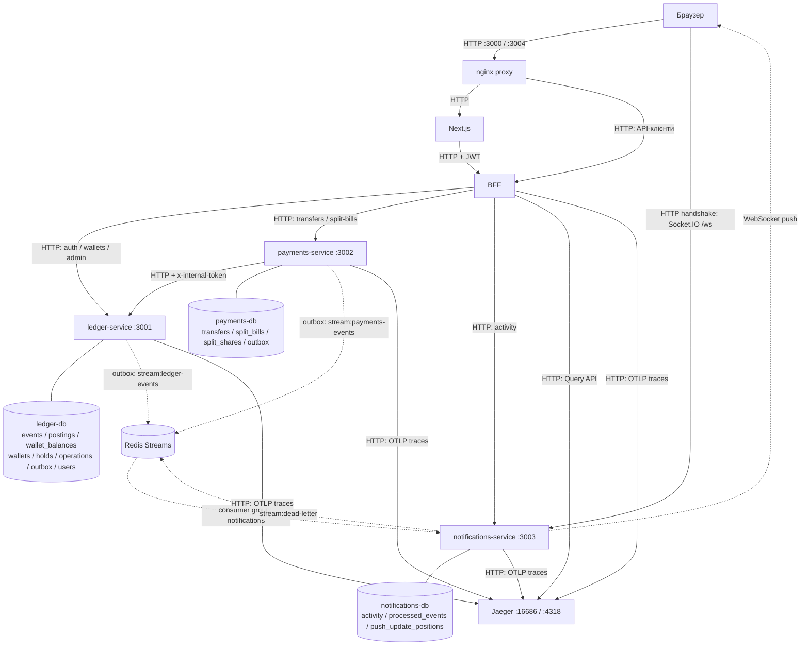

# P2P Ledger

Мультивалютні гаманці (USD/EUR/UAH), P2P-перекази та split-рахунки за
[технічним завданням](ЗАВДАННЯ.md): event sourcing, CQRS, double-entry,
оркестрована сага, Redis Streams, Socket.IO й OpenTelemetry.
Поповнення та виведення — локальні моки без зовнішніх банківських інтеграцій.
Стек: Node 20, NestJS 10, Next.js 14 (App Router), TypeORM 0.3, PostgreSQL 16, Redis 7.

## Коротко

**Що зроблено**

- Ledger: append-only event store у PostgreSQL, проєкції балансів, подвійний запис,
  ідемпотентні команди, холди та звірка `Σ дебетів = Σ кредитів`.
- Payments: оркестрована сага переказу (холд → підтвердження → зарахування або
  компенсація), FX-курс із кешем, split-рахунки з оплатою часток і нагадуваннями.
- Notifications: споживач Redis Streams, стрічка активності, Socket.IO push.
- BFF і Next.js: єдиний REST API, сесія в httpOnly-cookie, live-статус переказу,
  адмінка з event-логом, звіркою та traces з Jaeger.
- Тести кожного пакета, system-тести через увесь стек і race-тест подвійного списання в CI.

**Запуск:** `docker compose up --build`, далі [localhost:3000](http://localhost:3000).
Адмін — `admin@example.com` / `change-me-admin`; [демо за шість дій](#демо-за-шість-дій),
[system і race тести](#тести-та-результати-race-тесту).

| Де | Що |
|---|---|
| `apps/ledger-service` | Auth, гаманці, event store, holds, звірка |
| `apps/payments-service` | Сага переказів, FX, split-рахунки |
| `apps/notifications-service` | Activity, Socket.IO `/ws` |
| `apps/bff`, `apps/frontend` | Публічний API та UI |
| `tests/system` | System-тести й race-скрипт `load/double-spend.ts` |
| `contracts`, `.github/workflows` | Спільні правила (валюти, суми, хеш запиту, перевірка JWT, env, outbox relay) і CI |

Свідомі компроміси й межі — в [обмеженнях](#обмеження-та-подальші-зміни).
Нижче — деталі.

## Зміст

- [Запуск і демо](#запуск-і-демо)
- [Архітектура та вибір технологій](#архітектура-та-вибір-технологій)
- [Модель узгодженості та облік](#модель-узгодженості-та-облік)
- [Сага та компенсація](#сага-та-компенсація)
- [Події, брокер та спостережуваність](#події-брокер-та-спостережуваність)
- [Знайдені проблеми стартового коду](#знайдені-проблеми-стартового-коду)
- [Стартовий код і сумісність](#стартовий-код-і-сумісність)
- [Тести та результати race-тесту](#тести-та-результати-race-тесту)
- [Межа Server/Client Components](#межа-serverclient-components)
- [Обмеження та подальші зміни](#обмеження-та-подальші-зміни)

## Запуск і демо

Потрібні Docker із Compose v2 та вільні порти з таблиці. З кореня репозиторію:

```bash
docker compose up --build
```

Compose читає `.env.example` кожного пакета; копіювати файли для цього запуску
не потрібно. Для запуску у фоні з очікуванням готовності:
`docker compose up -d --build --wait --wait-timeout 180`.
Усі опубліковані порти прив’язані до `127.0.0.1`. Порти 3000 і 3004 публікує nginx
([proxy/nginx.conf](proxy/nginx.conf)) — єдиний публічний вхід до frontend і BFF.

| Компонент | Адреса / порт хоста | Призначення |
|---|---|---|
| Frontend | [localhost:3000](http://localhost:3000) через proxy | Гаманці, перекази, рахунки, активність, адмінка |
| Ledger | [Swagger :3001](http://localhost:3001/docs) | Auth, гаманці, holds, event-лог, reconciliation |
| Payments | [Swagger :3002](http://localhost:3002/docs) | Перекази та split-рахунки |
| Notifications | [Swagger :3003](http://localhost:3003/docs) | Activity та Socket.IO `/ws` |
| BFF | [Swagger :3004](http://localhost:3004/docs) через proxy | Публічний REST API та `/dashboard` |
| Jaeger | [UI :16686](http://localhost:16686), OTLP HTTP 4318 | Traces та Query API |
| PostgreSQL | ledger 5433, payments 5434, notifications 5435 | Усередині мережі кожна БД на 5432 |
| Redis | 6379 | Усередині мережі `redis:6379` |

У кожного Nest-сервісу є `/health` і `/metrics`. Адмін створюється на старті з
`ADMIN_EMAIL` / `ADMIN_PASSWORD` у [ledger .env.example](apps/ledger-service/.env.example):
`admin@example.com` / `change-me-admin`. Звичайних користувачів створюйте через UI.

### Демо за шість дій

1. На [сторінці реєстрації](http://localhost:3000/register) створіть двох
   користувачів із різними email і паролями від 8 символів: поля «Email»,
   «Пароль», кнопка «Зареєструватись». Для зміни акаунта натискайте «Вийти»
   в меню, потім «Увійти» на `/login`. Залиште відкритим акаунт першого.
2. У «Гаманці» (`/wallets`) виберіть «Валюта» → USD і натисніть
   «Відкрити гаманець». У його полі «Сума операції» введіть `100`, натисніть
   «Поповнити»: доступно стане `100.00 USD`. Кнопкою біля ID скопіюйте повний
   ID гаманця та збережіть для адмінки.
3. У «Переказ» (`/transfers/new`) виберіть USD у «Гаманець відправника»,
   заповніть «Email отримувача» email другого, «Сума (USD)» — `10`,
   «Валюта отримувача» — USD. Натисніть «Переказати», дочекайтеся
   «Переказ завершено». Натисніть «Новий переказ» й повторіть із EUR у
   «Валюта отримувача»: за типовим курсом другий отримає `9.20 EUR`.
4. У «Спільні рахунки» (`/split-bills`) заповніть «Назва» — `Демо вечеря`,
   «Загальна сума» — `5`, «Валюта» — USD, «Поділ» — «Порівну»,
   «Учасники (по одному в рядку)» — лише email другого. Натисніть
   «Створити рахунок». Увійдіть другим, відкрийте цей рахунок у списку,
   натисніть «Підтвердити свою частку», виберіть USD у «Гаманець для оплати»
   й натисніть «Сплатити свою частку». Дочекайтеся «Сплачено» та
   «Рахунок закрито»; у другого залишиться `5.00 USD` і `9.20 EUR`.
5. Увійдіть адміном із `ADMIN_EMAIL` / `ADMIN_PASSWORD` у
   `apps/ledger-service/.env.example` (типово `admin@example.com` /
   `change-me-admin`). Відкрийте «Адміністрування» (`/admin`), вставте
   збережений ID першого гаманця в «ID гаманця» й натисніть «Показати».
   Перегляньте «Журнал подій», «Звірка» («Звірка успішна», розбіжностей `0`)
   і «Трасування» з тривалістю кроків переказів. Без дат звірка охоплює всю історію.
6. За бажанням увійдіть другим: у USD-гаманці введіть `20` у «Сума операції»
   й натисніть «Зняти». Очікується «Недостатньо коштів», баланс лишиться `5.00 USD`.

### Конфігурація та дані

Публічні `change-me-*` і паролі БД призначені для локальної демонстрації.
Compose явно задає `NODE_ENV=development`; runtime-образи Nest за замовчуванням
мають `production`. Усі Nest-сервіси перевіряють обов’язкові env на старті;
у production також відхиляються JWT/internal секрети коротші за 32 символи
та `change-me-*`, а ledger вимагає власний admin-пароль від 12 символів.
Узгодьте `JWT_ACCESS_SECRET` між Nest-сервісами, `INTERNAL_API_TOKEN` — між ledger/payments.

Міграції трьох БД автоматичні, `synchronize: false`; стара CRUD-схема ledger несумісна.
Для непотрібних старих dev-даних можна виконати `docker compose down -v`:
**це видаляє всі БД та Redis-том поточного Compose-проєкту**.
Для нової інсталяції скидання не потрібне; важливі дані спершу збережіть.
Звірка без зміни проєкції: `docker compose exec ledger-service npm run reconcile`
(код виходу 1 означає розбіжності).

Для хостової розробки на Node 20 скопіюйте `.env.example` у `.env` пакетів.
Підніміть БД/Redis/Jaeger, замініть контейнерні хости на localhost і порти з таблиці;
`OTEL_EXPORTER_OTLP_ENDPOINT=http://localhost:4318`. У frontend використайте
`BFF_URL=http://localhost:3004`, `WS_PUBLIC_URL=http://localhost:3003`.
У пакеті: `npm ci`, потім `npm run start:dev` (backend) або `npm run dev` (frontend).
Зупиніть контейнер сервісу перед хостовим запуском на тому самому порту;
для frontend і BFF порт тримає `proxy`.

## Архітектура та вибір технологій



Суцільні стрілки — HTTP, пунктирні — події та WebSocket push.
Лінії без стрілок — доступ до власної PostgreSQL. Прямих читань чужої БД немає.

| Межа | Відповідальність |
|---|---|
| Ledger | Джерело істини: події, проводки, проєкції, holds, ідемпотентні команди. Auth — окремий модуль цього процесу; гаманець знає лише `ownerId`, без ORM-зв’язку з User. |
| Payments | Стан саги, split-рахунки, risk-правила та внутрішній FX-модуль із TTL-кешем. Гроші змінює через internal HTTP API ledger. |
| Notifications | Власна activity-проєкція, дедуплікація та персональні WS-кімнати з JWT-handshake. |
| BFF | Явні маршрути, JWT/DTO, агрегація dashboard, доступ адміна до Jaeger. БД немає. |
| Frontend | SSR, форми та live-стан. HTTP через BFF, Socket.IO — напряму до notifications. БД немає. |

| Рішення | Обґрунтування та компроміс |
|---|---|
| PostgreSQL append-only event store | Подія, проводки, проєкція та outbox атомарні в наявній БД; окрема СУБД зайва для цього обсягу. Replay і версіонування реалізовані в коді. |
| Redis Streams | Журнал доменних подій, consumer groups, ACK і reclaim в одному контейнері. Retention обмежений; retries, DLQ та передавання trace-контексту реалізовані явно. |
| Оркестрована сага | Payments має одного власника стану, порядку й компенсації; збережений стан дозволяє продовжити переказ після збою. Компроміс — окремий координатор зі сховищем стану та lease. |
| REST BFF на NestJS | Єдина HTTP-точка, агрегація та Swagger для одного клієнта. Додає мережевий перехід; незалежні читання виконуються паралельно. |

## Модель узгодженості та облік

| Гарантія | Межа та механізм |
|---|---|
| Сильна узгодженість грошей | Одна ledger-транзакція: події, проводки, проєкції, результат `operations`, outbox. CQRS розділяє запис і читання логічно; баланс не відстає від успішної команди. |
| Немає double spend | `wallet_balances FOR UPDATE` у порядку wallet ID, перевірка коштів, CHECK `available >= 0` і `held >= 0`; capture блокує обидва гаманці. |
| Double-entry | `EventStore.append` до запису перевіряє Σ DEBIT = Σ CREDIT окремо для кожної події та валюти. SQL CHECK захищає суми рядків; міжрядковий інваріант перевіряє доменний код. |
| Незмінна історія | UNIQUE `(stream_id, stream_version)`; тригери забороняють UPDATE/DELETE/TRUNCATE `events` і `postings`. Виправлення — новими подіями. |
| Одна команда на ключ | Ledger: PK `operations.operation_id`; payments: UNIQUE `(sender_user_id, idempotency_key)` і хеш тіла. Паралельні повтори повертають збережений результат. |
| Атомарний фінал оплати частки | Стан саги, `PAID` або повернення частки в `ACCEPTED` та outbox комітяться разом у payments. |
| Eventual між сервісами | Сага наздоганяє результат ledger через ідемпотентні HTTP-команди. Outbox доставляє події в notifications; фінал потребує відновлення доступності залежностей. XA немає. |
| Ідемпотентна activity | Одна notifications-транзакція: `processed_events`, activity та позиції push. Emit і ACK після коміту; пропущений push відновлюється REST на connect. |

Суми в БД — `bigint` у мінорних одиницях, у JSON для них — десяткові рядки.
API приймає додатний `amount: number` ≤ 1 000 000 з ≤ 2 знаками після коми;
перетворення через рядок усуває похибку `amount * 100`.
`balance = available + held`: резерв належить власнику, але недоступний до витрати.
Баланс рахунку гаманця = Σ CREDIT − Σ DEBIT.

| Операція | DEBIT | CREDIT |
|---|---|---|
| Deposit X | `system:external:CUR` X | `wallet:W:available` X |
| Withdraw X | `wallet:W:available` X | `system:external:CUR` X |
| Hold X | `wallet:W:available` X | `wallet:W:held` X |
| Release X | `wallet:W:held` X | `wallet:W:available` X |
| Capture, одна валюта | `wallet:S:held` X | `wallet:R:available` X |
| Capture, USD→EUR | `wallet:S:held` X USD; `system:fx:EUR` Y EUR | `system:fx:USD` X USD; `wallet:R:available` Y EUR |

FX-курс має 8 знаків; зарахування округлюється вниз до мінорної одиниці.
`GET /admin/reconciliation?from&to` у `REPEATABLE READ READ ONLY` звіряє
дебет/кредит за період `[from, to)` і повний replay усіх подій із проєкцією.
Відповідь містить `perCurrency`, `projectionMismatches`, `ok`; проєкція не перезаписується.
API/CLI приймають `YYYY-MM-DD` (UTC) або ISO дату-час із секундами й часовим поясом;
week/ordinal/basic та неіснуючі дні відхиляються до SQL, потрібне `from ≤ to`.

## Сага та компенсація

`POST /transfers` із JWT та `Idempotency-Key` (1–128 символів) → `202/PENDING`;
той самий ключ і тіло → `200`, інше тіло → `422 IDEMPOTENCY_KEY_REUSED`.
Одержувач — email (`toWalletIdentifier`, чому без username — у
[обмеженнях](#обмеження-та-подальші-зміни)), `toCurrency` необов’язкова.
Відправник бачить свій переказ завжди, отримувач — лише `COMPLETED`, іншим — 404.

| Крок | Дія | Остаточна відмова | Невизначений результат / вичерпання спроб |
|---|---|---|---|
| RISK_CHECK | `TRANSFER_MAX_AMOUNT`, `BLOCKED_EMAILS` | FAILED без зміни грошей | Неочікувана помилка повторюється до ліміту, потім FAILED. |
| RESOLVE_RECIPIENT | Пошук за email, заборона self-transfer за userId, ensure гаманця | FAILED; порожній створений гаманець лишається | Backoff до ліміту, потім FAILED. |
| FX_QUOTE | Зберегти курс, його час і суму зарахування | FAILED, холду ще немає | Повтор до ліміту, потім FAILED. |
| HOLD | available → held, `transfer:<id>:hold` | FAILED, ledger відхилив команду й запам’ятав відмову під operationId | Повтор тим самим operationId; після ліміту RELEASE_HOLD, бо холд міг з’явитися. |
| CONFIRM | Курс не застарів, отримувач не frozen | COMPENSATING → RELEASE_HOLD → FAILED | Повтор до ліміту, потім RELEASE_HOLD. |
| CAPTURE | Атомарно held відправника → available отримувача, `transfer:<id>:capture` | RELEASE_HOLD → FAILED | Повтор capture; після ліміту перевірити холд: CAPTURED → COMPLETED, інший стан → компенсація. Недоступний ledger → далі чекати з backoff. |
| RELEASE_HOLD | held → available, `transfer:<id>:release` | NOT_FOUND → FAILED; HOLD_NOT_ACTIVE / IDEMPOTENCY_KEY_REUSED → перевірити холд: CAPTURED → COMPLETED, RELEASED/немає → FAILED, ACTIVE → повтор | Без ліміту повторів, доки результат не визначено; COMPENSATING зберігається. |
| DONE / сповіщення | COMPLETED та outbox зафіксовані | Збій сповіщення не відкочує гроші | Relay/consumer повторюють доставку, REST повертає стан. |

Таймаут/5xx/breaker open означає невідомий результат, а не відмову.
Невідомий capture не компенсується наосліп. Release передає `walletId`:
для ще не створеного холду ledger під блокуванням гаманця лишає слід в `operations`,
тож запізнілий place отримує `HOLD_NOT_ACTIVE`. Відмову place (409) ledger зберігає
в `operations` під operationId так само, як успіх: спроба, що застрягла й дійшла вже
після відмови повтору, отримує ту саму відмову, тож холд після FAILED не з’являється
за будь-якої причини повтору (таймаут, падіння runner'а, втрачений lease). Capture/release серіалізуються;
фінал визначається за станом холду. Після компенсації FAILED зберігає `RELEASE_HOLD`;
`DONE` буває лише при COMPLETED.

Інтервальний runner (`@nestjs/schedule`) бере lease `locked_until`, виконує HTTP поза транзакцією,
комітить перехід та outbox окремою транзакцією. Прострочений lease підбирається
автоматично; запізнілі результати старого runner відкидаються.
`attempts` рахується на крок; backoff — `min(SAGA_RETRY_BASE_MS × 2^attempts, 60000)` мс.
`opossum` обмежує виклики ledger; 401/403/408/429 повторюються, інші 4xx — остаточні.
`CB_TIMEOUT_MS < SAGA_STEP_TIMEOUT_MS`, `FX_CACHE_TTL_MS < FX_MAX_QUOTE_AGE_MS`.
HTTP-бюджети ledger/BFF/frontend: типово 3000/5000/8000 мс від спільного `CB_TIMEOUT_MS`.

### Split-рахунки

`POST /split-bills` задає title, totalAmount, currency, mode, participants та dueAt.
У `EQUAL` залишок копійок отримує перший учасник; у `CUSTOM` сума часток має
дорівнювати загальній. До 20 зареєстрованих учасників, без повторів та ініціатора;
частки вкладаються в ліміт переказу. `amount: null` → 400 через DTO/ValidationPipe,
пропущена сума допустима для EQUAL. `dueAt` необов’язкова; якщо задана — у майбутньому.

Власна частка: `PENDING → ACCEPTED` через accept, потім pay із `fromWalletId`
та `Idempotency-Key` запускає ту саму сагу: `PAYING → PAID`, при відмові → `ACCEPTED`.
Гаманець платника має валюту рахунку. Умовний UPDATE з ACCEPTED і вставка переказу
в одній транзакції запобігають подвійній оплаті; хеш ключа включає частку.
Агрегат рахунку: жодної PAID → PENDING, частина → PARTIALLY_PAID, усі → SETTLED.
Воркер `split-overdue` нагадує про прострочені PENDING/ACCEPTED через
`SplitShareOverdue`, не частіше `SPLIT_REMINDER_INTERVAL_MS`; без dueAt нагадувань немає.

## Події, брокер та спостережуваність

Event store: `event_id`, `global_position`, `stream_id`, `stream_version`,
`event_type`, `schema_version`, `payload`, `metadata`, `recorded_at`.
Metadata: operationId та опційні actorUserId/transferId/traceparent; грошовий payload:
`postings[]` з account/currency/direction/amountMinor. `now()` спільний для транзакції.

| Подія ledger | Коли записується |
|---|---|
| WalletOpened | Ensure нового гаманця; повтор не дублює подію. |
| MoneyDeposited / MoneyWithdrawn | Поповнення / виведення зі збалансованими проводками. |
| TransferInitiated + HoldPlaced | Разом при резервуванні коштів. |
| HoldReleased + TransferFailed | Разом при release з причиною; без причини лише HoldReleased, без самого холду лише слід операції. |
| TransferCompleted | Одна capture-подія з проводками обох сторін та FX. |
| WalletFrozen | Заморожування без грошових проводок. |

Переказні події належать stream відправника; admin-журнал отримувача також
включає події з проводками його рахунків. При replay та читанні журналу
[upcaster](apps/ledger-service/src/ledger/domain/upcasters.ts) перетворює
`MoneyDeposited` v1 `{ amount: "10.00" }` у v2 `{ amountMinor: "1000", postings: [...] }`
у пам’яті. Історичні рядки не змінюються; інші поточні доменні схеми — v1.

Інтеграційна схема незалежна від доменної, зараз version 1:

```ts
interface IntegrationEvent<T> {
  eventId: string;
  type: string;
  version: number;
  occurredAt: string;
  producer: 'ledger-service' | 'payments-service';
  userIds: string[];
  position?: string; // Стабільний outbox.id, десятковий bigint.
  traceparent?: string | null;
  payload: T;
}
```

Relay → `stream:ledger-events` / `stream:payments-events` із полями eventId,
type, version, traceparent, envelope (JSON). XADD і `published_at` не атомарні;
дубль зберігає eventId/position. Consumer group `notifications`: XREADGROUP,
транзакція БД, emit, XACK; після падіння — XAUTOCLAIM.
Невідомий type → warn/ACK; непідтримувана версія відомого type → DLQ/ACK;
помилка обробки → повтор до `CONSUMER_MAX_DELIVERIES`, потім `stream:dead-letter`.
Запис DLQ та ACK атомарні. Доставка at-least-once залежить від retention `MAXLEN ~`.

`push_update_positions` за producer/event/resource_id відкидає застарілий push
за стабільною position, а не Redis ID доставки. Конверти без position зберігають
activity та ACK без state push: продюсерів і notifications оновлюйте разом.
Ledger дає `wallet.balance` з грошових подій; TransferInitiated/TransferFailed
не дублюють push від HoldPlaced/HoldReleased. Payments дає `transfer.status`,
а фінальні перекази та split-події — activity; deposit/withdraw activity походить із ledger.
Socket.IO `/ws` приймає access JWT, сервер визначає кімнату `user:<userId>`.

OTel завантажується до HTTP/ORM/Redis/Pino. Контекст проходить через
`transfers.traceparent`, outbox, `publish <type>` та `process <type>`;
кожна спроба `saga.step <STEP>` лишається в trace запиту з `transfer.id`.
У Jaeger шукайте payments-service / `POST /transfers` або
`POST /split-bills/:id/shares/:shareId/pay` (оплата частки). Адмінка через
BFF `GET /admin/traces` шукає trace за першим кроком саги `saga.step RISK_CHECK`:
так видно сагу з будь-якого запиту, а запити, що сагу не запустили (відмова валідації, повтор за ключем),
місця в списку не займають. Найновіші trace першими, тривалість кожної спроби — зі span, у мілісекундах.
JSON-логи містять trace_id/span_id (null поза span), секретні заголовки маскуються.
`/metrics`: Node/process, у payments також `transfers_total{status}` та
`saga_step_duration_seconds{step}`. Метрики процесу не замінюють фінансовий журнал.

### Індекси та обмеження

Міграції [ledger](apps/ledger-service/src/migrations), [payments](apps/payments-service/src/migrations)
та [notifications](apps/notifications-service/src/migrations) фіксують схеми; PK/UNIQUE теж є індексами.

| Індекси | Для чого |
|---|---|
| Ledger: UNIQUE users(email), wallets(owner_id, currency) | Пошук користувача, один гаманець на валюту. |
| Events: PK global_position, UNIQUE event_id та (stream_id, stream_version), recorded_at | Replay, порядок stream, звірка періоду. |
| Postings: account, operation_id, recorded_at; PK operations(operation_id), holds(hold_id), wallet_balances(wallet_id); holds(wallet_id, status) | Журнал, ідемпотентність, точкові блокування та пошук холдів. |
| Ledger/payments outbox: UNIQUE event_id, частковий id WHERE published_at IS NULL | Порядок невідправлених подій. |
| Transfers: UNIQUE (sender_user_id, idempotency_key), (status, next_attempt_at), (sender_user_id, created_at), recipient_user_id, split_share_id | Повтори, runner, списки та оплата частки. |
| Split: (creator_user_id, created_at), UNIQUE (creator_user_id, idempotency_key), частковий due_at; shares: participant_user_id, UNIQUE (bill_id, participant_user_id) | Ініціатор, повтори, нагадування, видимість учасника. |
| Notifications: PK processed_events(event_id), push_update_positions(producer, event, resource_id); activity(user_id, created_at), (user_id, type) | Дедуплікація, порядок push та фільтри стрічки. |

## Знайдені проблеми стартового коду

| Проблема | Як проявлялася | Тест / реалізація | Виправлення |
|---|---|---|---|
| Double spend / lost update | 20 паралельних withdraw(10) зі 100 проходять; паралельні deposit втрачають оновлення | [wallets-concurrency](apps/ledger-service/test/e2e/wallets-concurrency.e2e-spec.ts) | Транзакція, FOR UPDATE, bigint, event store та CHECK. |
| IDOR гаманця | Користувач B читає/змінює гаманець A за ID | [wallets-access](apps/ledger-service/test/e2e/wallets-access.e2e-spec.ts) | Пошук за id + ownerId; чужий → 404. |
| Невалідні ID та суми | Не-UUID, 0.001, надмірна сума; `1e-7` дає TypeError у штатному decimal-валідаторі | wallets-access, [money-contract](apps/ledger-service/test/money-contract.spec.ts) | ParseUUIDPipe та IsMoneyAmount з межами й точністю. |
| «Зелений» тест овердрафту | Прибрати відмову withdraw: старий тест без await усе одно проходить | [wallets.service.spec.ts](apps/ledger-service/test/wallets.service.spec.ts), мутація | Await rejects, expect.assertions, перевірка відсутності запису. |
| Гонка ensure гаманця | Паралельний findOne → save створює дублікати однієї валюти | wallets-concurrency | UNIQUE(owner_id, currency), INSERT ON CONFLICT. |
| Гаманці UI завжди 401 | Вхід → /wallets; запит не містить Bearer із cookie | [Frontend HTTP](apps/frontend/test/http.test.cjs) | Серверний bffFetch передає токен, middleware оновлює access. |
| Payments без авторизації | Каркас приймає запити без JWT та власника | [transfers e2e](apps/payments-service/test/e2e/transfers.e2e-spec.ts) | JWT-guard, перевірка власності, отримувачу лише COMPLETED. |
| Запасні JWT-секрети | Запустити ledger без обов’язкових env | [env-startup](apps/ledger-service/test/env-startup.spec.ts) | Fail-fast валідація, без fallback; сила секретів у production. |
| Bcrypt обрізає refresh до 72 байтів | Різні JWT зі спільним префіксом відповідають одному хешу | [auth-rotation](apps/ledger-service/test/auth-rotation.spec.ts), [HTTP](apps/ledger-service/test/e2e/auth-rotation.e2e-spec.ts) | SHA-256 усього токена, timingSafeEqual, jti, атомарна ротація. Паролі лишаються bcrypt. |
| ORM змішує auth/ledger | User ↔ Wallet зв’язує контексти | [Wallet](apps/ledger-service/src/wallets/entities/wallet.entity.ts), [wallets e2e](apps/ledger-service/test/e2e/wallets.e2e-spec.ts) | Лише ownerId без зв’язку з User, баланс — окрема проєкція. |
| CI без lockfiles / tests | npm cache потребує lockfile; Jest payments без тестів завершується з кодом 1 | [CI-конфігурація](.github/workflows/ci.yml) | Lockfiles, npm ci, реальні suites без passWithNoTests. |
| Ledger не стартує з Postgres | Nullable union refreshTokenHash визначається як Object | `docker compose up --build` | Явний тип varchar колонки. |
| Неправильний шлях build | test/ потрапляє у збірку, вихід dist/src/main замість dist/main | [Конфігурація збірки](apps/ledger-service/tsconfig.build.json), [Dockerfile](apps/ledger-service/Dockerfile) | tsconfig.build.json виключає тести. |
| Хостовий bcrypt в Linux-образі | COPY . . після локального install дає Exec format error | Docker build на macOS із хостовими node_modules | .dockerignore для node_modules/dist/.env. |

Коміти з regression-тестами та відповідними виправленнями:
[конкурентні гроші](https://github.com/JuFios/p2p-ledger/commit/80a66d4367c525d9d17b2f11c0bd9e2e881fc725) → [блокування](https://github.com/JuFios/p2p-ledger/commit/4ba7c94df4afee3d6d60022e6972eff67850feea),
[IDOR/суми](https://github.com/JuFios/p2p-ledger/commit/f374002077e22ba2b97367d2e0f2bea942fd0165) → [валідація й доступ](https://github.com/JuFios/p2p-ledger/commit/00728ee21cd78f4751dfa3d8ad83d24390c563f6),
[decimal edge](https://github.com/JuFios/p2p-ledger/commit/24417a739aab63074382ccfe76c39983e062cc94) → [валідатор](https://github.com/JuFios/p2p-ledger/commit/7ba0722a5b4dd4f7f62ead6ce028eaab62e022a4).
Для овердрафту — [виправлення асинхронних перевірок тесту](https://github.com/JuFios/p2p-ledger/commit/f49cdbf4173d25c041fabf64dee2644159fd9a50).

## Стартовий код і сумісність

Збережено окремі пакети, Node/Nest/Next major, DTO login/register, bcrypt паролів,
основу Compose. Login/register мають ті самі поля, submit і роутинг;
змінено оформлення й підписи, а login на 429 показує час очікування з `Retry-After`,
на 5xx — недоступність сервісу, а не «невірний пароль». Спільного Prettier/tsconfig та підключеного брокера
notifications у фактичному стартері не було, попри опис у ТЗ.

| Що змінено | Навіщо |
|---|---|
| Ledger CRUD → event store, проєкції, міграції; User без Wallet relation | Double-entry, replay, незалежний auth-контекст. |
| Auth: env, throttle, повний refresh hash, CAS-ротація, sid, logout | Безпечна конфігурація й відкликання сесії, включно з конкурентним refresh/logout. Новий login змінює sid; refresh зберігає. Конкурентний email → 409; інші помилки БД не маскуються. |
| Payments-каркас → сага/split; DTO/JWT/TypeORM/scheduler | Реальні перекази, компенсація, оплати й нагадування. |
| Notifications-заглушка → БД/activity/consumer/WS | Ідемпотентні сповіщення та real-time. |
| Bootstrap/AppModule трьох backend | Ранній tracing, Pino, Swagger, валідація, health БД/Redis, завершення воркерів і SDK на SIGTERM. Redis down — деградація без зупинки ledger/REST activity. |
| Frontend api/layout/wallets | BFF, SSR + live, refresh, навігація після входу; `(authenticated)` усуває кешовану анонімну шапку. Tailwind і локальний Inter. |
| Compose/Docker/CI | Додано БД, Redis, BFF, Jaeger, nginx-proxy перед frontend/BFF, healthcheck; AOF/том Redis та localhost-порти. Окремі test/build/runtime targets, npm ci, USER node; CI для кожного пакета й system/race. |

Зміни контрактів: balance лишився рядком, тепер `available + held`; додано
available/held/frozen. Витрати обмежені available, frozen блокує гроші, крім release.
Чужий гаманець → 404, не-UUID → 400; строгі межі amount описано вище.
`POST /wallets` — ensure за власником/валютою. Deposit/withdraw і split-create
мають необов’язковий Idempotency-Key; UI завжди передає його. Без ключа
кожен запит — нова операція. Transfers і split-pay вимагають ключа.
`BFF_URL` замінив прямі URL frontend; runtime `WS_PUBLIC_URL` замінив NEXT_PUBLIC_WS_URL.
Перехід bcrypt refresh → SHA-256 потребує повторного входу; міграція AddRefreshSession
зберігає сумісність попередніх SHA-256 токенів без sid.

### Чому змінено наявні тести

| Набір | Причина адаптації; збережені гарантії |
|---|---|
| Ledger wallets.service | Моки EntityManager/EventStore замість CRUD-репозиторію; депозит, відмова овердрафту без запису й власність. HTTP-арифметика перевіряється проти Postgres. |
| Auth rotation/logout | Моки звіряють повний умовний UPDATE із sid; фікстури старих токенів відповідають міграції. Перевіряється незмінність іншої сесії замість відсутності SQL-запиту. |
| Payments lease, notifications handler/shutdown | Додано залежність metrics та позицію доставки для нових компонентів; перевірки lease, дедуплікації та завершення збережені. |
| Mapper / socket-expiry | Balance очікується один раз від грошової події, token fetch — один раз на handshake; lifecycle-події перевіряються окремо. |
| Outbox e2e | Очікування published_at до дедлайну: XADD видимий раніше PostgreSQL COMMIT. |
| Frontend persistence/client/parsers | Фікстури отримали userId, step, currency/toCurrency та явний парсер. Нові рядкові стани дозволені, malformed/missing/валюти лишаються строгими; ключі, polling і захист від старих відповідей збережені. |
| Frontend format/BillDetails | UTC SSR → пояс браузера замість фіксованого поясу; перевірки hydration, DST і включного календаря. |
| Payments split-validation | Два direct-call null тести проходять реальний ValidationPipe → сервіс: null відхиляється до hash/БД, з ключем і без. HTTP e2e збережено. |
| BFF Jaeger, frontend login HTTP | Додано перевірки `X-Forwarded-For`: IP клієнта не йде в Jaeger, login передає його в BFF. Traces шукаються за першим кроком саги `saga.step RISK_CHECK` замість кореневого `POST /transfers`, щоб охопити й оплату частки; порядок і тривалість спроб перевіряються як раніше. |
| Payments e2e: HTTP-двійник ledger | Як і ledger, двійник запам’ятовує відмову place (409) під operationId і повертає її на повтор. Release і capture у двійнику без змін. |
| Tracing-env (усі сервіси) | Таймаут дочірнього процесу 15 → 60 с: на завантаженій машині старт ts-node і OTel SDK не вкладався в 15 с. Перевірка експорту в collector і `service.name` з `.env` та сама. |

Регресійні тести охоплюють переставлені відповіді polling/live/manual і збереження помилки гаманців до успішного повного оновлення,
DST опівночі, logout за проксі, конкурентну реєстрацію на PostgreSQL, ліміт невдалих логінів за IP (успішні входи й паралельні спроби)
та заморозку отримувача між HOLD і CONFIRM (ledger на PostgreSQL зі звіркою) і між CONFIRM і CAPTURE (сага).
Для logout очікується відносний Location, для реєстрації — один акаунт, решта відповідей 409 та чинні login/refresh переможця.

Технічні правила й шаблон relay мають одне джерело в `contracts/` та похідні
копії в незалежних Docker build contexts. `node scripts/sync-contracts.cjs`
оновлює їх, `--check` у CI відхиляє drift; спільних ORM/БД/runtime-імпортів немає.
Ліміти/валюти змінюйте в джерелі константи, адреси й налаштування — через env
центрального модуля сервісу. Контрактні тести звіряють межі та копії.

## Тести та результати race-тесту

У backend-пакеті: `npm ci`, `npm run lint`, `npx tsc --noEmit`, `npm test`,
`npm run test:e2e`. Ledger/payments/notifications e2e потребують власних БД
`ledger_e2e` / `payments_e2e` / `notifications_e2e` (створити через createdb у
відповідному db-контейнері). Не використовуйте dev-БД: reconciliation читає весь event store.
Notifications потребує окремого Redis на 6380; ledger/payments теж задайте
`REDIS_PORT=6380`, щоб тестові події не потрапляли в dev notifications.
BFF e2e використовує HTTP-двійники без БД; payments e2e — справжній Postgres
та HTTP-двійник ledger. Frontend: `npm ci`, lint, tsc, `npm run build`, `npm test`;
production HTTP-тестам потрібна готова `.next`, DOM-тести виконують реальні React-компоненти.
Стрічка перевіряє зараховану суму/валюту отримувача FX і списану суму відправника.

Повний system/race через реальні сервіси (Compose v2.24.4+, із кореня):

```bash
export COMPOSE_PROJECT_NAME=p2p-ledger-system
export COMPOSE_FILE=docker-compose.yml:docker-compose.test.yml
docker compose build system-tests
docker compose run --rm --no-deps system-tests sh -c 'npm run lint && npx tsc --noEmit'
docker compose up -d --build --wait --wait-timeout 180
docker compose run --rm --no-deps system-tests npm test
docker compose run --rm --no-deps system-tests npm run test:load
docker compose --profile test down -v --remove-orphans
unset COMPOSE_FILE COMPOSE_PROJECT_NAME
```

Override прибирає host-порти, створює окремі томи/мережу, піднімає тестові
ліміти та фіксує FX. `down -v` тут видаляє лише дані цього тестового проєкту.
CI запускає service jobs на всіх push/PR, system-e2e — на PR і push у solution;
при відмові друкує діагностику, тестові ресурси прибирає завжди.

[Race-скрипт](tests/system/load/double-spend.ts) запускає 50 одночасних переказів
по 10 USD з балансу 100 USD, кожен із власним ключем. Приклад результату в Docker
(Linux arm64, Node 20.20.2, tracing і notifications увімкнені):
2135 мс, 23.42 фінальних операцій/с.

| Результат | Значення |
|---|---:|
| COMPLETED | 10 |
| FAILED / INSUFFICIENT_FUNDS на HOLD | 40 |
| Інші відмови / незавершені | 0 |
| Відправник available / held, USD | 0.00 / 0.00 |
| Отримувач, USD | 100.00 |
| Reconciliation | ok, 0 розбіжностей |

| Час, мс | min | p50 | p95 | max |
|---|---:|---:|---:|---:|
| POST /transfers | 47 | 304 | 384 | 392 |
| POST → спостереження фіналу | 852 | 1489 | 2123 | 2126 |

Фінал спостерігається polling-ом кожні 500 мс від власного POST; це перевірка гонки.
Час залежить від середовища; порушення кількостей/балансів/reconciliation дає exit 1.

## Межа Server/Client Components

Server Components без кешу читають початкові гаманці/рахунки/активність через BFF;
адмінські event-лог, звірка та traces — незалежні Suspense-секції.
Client Components відповідають за форми, фільтри, Socket.IO, прогрес і повтори.
Split-create та accept — Server Actions; грошові мутації — fetch з явним ключем.
Підхід стартових login/register та серверне завантаження гаманців збережено.

Серверні виклики йдуть у BFF напряму; браузер — через `/api/bff/[...path]`,
що додає Bearer із httpOnly-cookie, передає ключ/JSON/status/Retry-After та
перевіряє Origin/Host для POST. BFF знову перевіряє JWT/DTO, сервіс-власник — права
й бізнес-правила. Internal API доступне лише з x-internal-token й не проксується.
Login лімітується за email (`LOGIN_RATE_LIMIT`) і окремо за невдалими спробами з IP
клієнта (`LOGIN_IP_RATE_LIMIT`) у спільному вікні `LOGIN_RATE_TTL_MS`: другий ліміт
зупиняє перебір одного пароля по багатьох акаунтах. Спроба резервується до перевірки
пароля й повертається, якщо відповідь не 401, тож успішні входи за спільним NAT
ліміт не витрачають, а паралельні запити його не перевищують. IP визначає nginx:
він перезаписує `X-Forwarded-For` адресою з'єднання, тож підставлений клієнтом заголовок
не діє. Frontend і BFF передають це значення далі, ledger бере останній запис.
Transfers і pay мають один спільний ліміт за userId (`TRANSFER_RATE_LIMIT`): обидва створюють переказ.
`/dashboard` паралельно повертає секції data/error, відмова одного джерела не ховає решту.

Middleware оновлює access через refresh; паралельні refresh об’єднуються в процесі,
успішна пара кешується на 30 с для запізнілих запитів зі старою cookie.
Тимчасовий збій refresh лишає cookie: API отримує JSON 503, сторінка — HTML 503 з повтором.
Login передає `Retry-After` ліміту, некоректне тіло запиту отримує 400, а відповідь BFF
без пари токенів — 502 без cookie. Статус BFF (зокрема 401 за невірних даних) передається
як є; непередбачений збій маршруту — 500, а не «невірний пароль».
Logout відкликає sid і очищає cookie; уже виданий access живе до свого exp.
`/api/auth/ws-token` віддає access у пам’ять сторінки для handshake; refresh лишається
в httpOnly-cookie. Cookie: SameSite=Lax, Secure при HTTPS. У localStorage токенів немає.

Connect/reconnect перечитує REST-стан; після JWT exp сокет перепідключається зі свіжим токеном.
Фонове опитування переказу й PAYING-рахунку послідовне;
спільна ревізія відкидає старі відповіді polling, ручних і live-оновлень.
Ключ і snapshot незавершеної спроби живуть у sessionStorage вкладки з userId;
мережеві/тимчасові 401/403/408/429/5xx повторюються тим самим ключем і тілом.
Без доступу до сховища ключ лишається в пам’яті до reload.
Невідомий HTTP status/step показується рядком із вимкненими діями;
невідомий або некоректний WS-стан запускає REST-refetch.

Дані/API/події — UTC. LocalTime дає однакові UTC SSR і першу гідрацію,
потім відображає пояс браузера; групи «Сьогодні/Вчора» теж локальні.
Календар звірки має включні дні «Від»/«До» та передає межі періоду в UTC.
Інтерфейс використовує Tailwind і локальний Inter; є світла/темна тема та loading/empty/error/offline стани.

## Обмеження та подальші зміни

- Моки: FX з env, ліміт у номінальних одиницях усіх валют, чорний список,
  deposit/withdraw. Реальних котирувань, fraud-моделі й банківських рейок немає.
- Версії Node 20 / Nest 10 / Next 14 збережено для сумісності стартера.
  Next 14 має відомі вразливості
  [Server Actions DoS](https://github.com/vercel/next.js/security/advisories/GHSA-p3m5-59mp-jv5r)
  та [WebSocket upgrade SSRF](https://github.com/vercel/next.js/security/advisories/GHSA-c4j6-fc7j-m34r).
  Перед публічним розгортанням потрібні оновлення залежностей і налаштування
  reverse proxy та мережевого доступу до внутрішніх сервісів.
- Redis AOF/том зберігають стріми між перезапусками, everysec допускає втрату
  останньої секунди при аварії. MAXLEN обрізає історію; після втрати Redis
  опублікований outbox автоматично не відтворюється. Потрібні backup/retention/replay.
  Jaeger зберігає traces у пам’яті; метрики скидаються з процесом.
- WS emit після коміту не гарантований, catch-up — REST на connect.
  Для кількох інстансів потрібні спільні WS-кімнати та узгодження порядку emit,
  refresh і rate limit. Runner чекає найповільнішу сагу пачки; пул зі звільненням
  слотів покращив би використання ресурсів.
- Відмову під ключем ідемпотентності ledger запам'ятовує лише для холду саги.
  Deposit/withdraw з тим самим `Idempotency-Key` після відмови (недостатньо коштів,
  frozen тощо) виконуються наново; UI після остаточної відмови генерує новий ключ.
  Строгіший варіант — так само зберігати їхню відмову в `operations`.
- `CONSUMER_NAME` за замовчуванням — hostname і pid: після перестворення контейнера
  старий консюмер лишається в групі `notifications`, його pending забирає XAUTOCLAIM
  через `CONSUMER_CLAIM_IDLE_MS`. Для тривалої роботи — стабільне ім'я або
  періодичний `XGROUP DELCONSUMER` консюмерів без pending.
- Consumer викликає XAUTOCLAIM перед кожним XREADGROUP — простіше, але під
  навантаженням це зайві звернення до Redis; достатньо раз на половину `CONSUMER_CLAIM_IDLE_MS`.
- Admin event-лог гаманця віддається повністю, без пагінації; для гаманців
  з великою історією потрібні `limit` і курсор за global_position.
- Один refresh-вхід на користувача: новий login відкликає попередній refresh.
  При недоступному BFF logout очищає локальні cookie, але серверне відкликання
  не гарантоване. Безключовий API-виклик не має гарантії від дубля після втрати відповіді.
- Одержувач переказу — лише email. У стартовому auth-модулі немає username;
  його додавання означає нову колонку з унікальністю, міграцію, зміну реєстрації
  та стартових сторінок login/register, а ТЗ просить не переписувати auth без потреби.
  Поле `toWalletIdentifier` дозволяє додати інший ідентифікатор без перейменування в API.
- Access JWT не містить sid, тому REST-сервіси та WS-handshake перевіряють лише
  підпис і exp. Після logout уже виданий access, зокрема відкритий сокет, живе до exp
  (`JWT_ACCESS_TTL`, типово 15 хв): notifications закриває сокет таймером на exp.
  Миттєве відкликання потребує sid в access і події відкликання сесії або перевірки
  в ledger на кожен запит.
- Access JWT підписуються HS256 спільним `JWT_ACCESS_SECRET`: видає лише ledger,
  решта перевіряє, але технічно будь-який сервіс із секретом може підписати токен.
  BFF, payments і notifications приймають лише HS256 і UUID у `sub` (спільна перевірка
  з `contracts/`). Стратегія ledger лишилась стартовою (змінено лише відмову від
  запасного секрету): вона не обмежує HMAC-алгоритм і формат `sub`, бо ТЗ просить
  не переписувати auth без потреби. Без секрету такий токен не підписати.
  Компроміс прийнято, бо всі сервіси в одній зоні довіри Compose і вже ділять
  `INTERNAL_API_TOKEN`. Для окремих зон довіри — RS256/ES256: приватний ключ лише
  в ledger, публічний або JWKS у решти; refresh лишається внутрішнім для ledger.
- Ліміт за IP спирається на nginx як на перший hop. Внутрішні сервіси довіряють
  `X-Forwarded-For` від будь-якого виклику в мережі Compose, тому їх порти мають
  бути закриті (див. нижче). За зовнішнім балансувальником nginx треба налаштувати
  `set_real_ip_from`/`real_ip_header`, інакше всі клієнти матимуть адресу балансувальника.
  Хостовий `npm run dev` працює без proxy, і там заголовок від клієнта не перезаписується.
- Для публічного розгортання потрібні власні секрети, TLS, закриті БД/Redis/metrics/docs,
  політика upgrade/egress для Next, резервні копії та міграція реальних даних.
  Поточний Compose — локальна демонстрація; готовність до production не заявляється.
